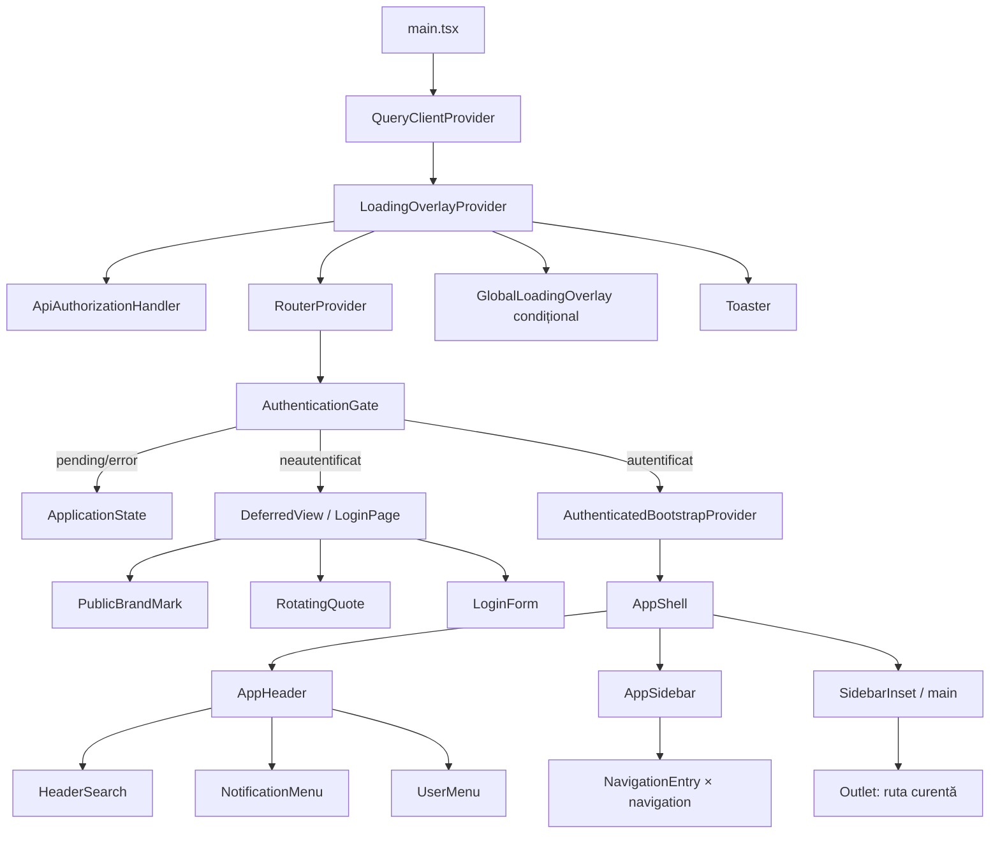

# Runtime comun tuturor rutelor

Acest fișier nu reprezintă o rută suplimentară. El detaliază infrastructura repetată prin referință în fiecare raport de rută.

## React component tree global

```text
<StrictMode> — frontend/src/main.tsx
└── <QueryClientProvider>
    └── <LoadingOverlayProvider> — frontend/src/app/LoadingOverlayContext.tsx
        ├── <ApiAuthorizationHandler /> — frontend/src/app/ApiAuthorizationHandler.tsx (fără DOM)
        ├── <RouterProvider>
        │   └── <AuthenticationGate> — frontend/src/app/AuthenticationGate.tsx
        │       ├── [bootstrap pending] <ApplicationState loading />
        │       ├── [bootstrap error] <ApplicationState action="Încearcă din nou" />
        │       ├── [neautentificat] <DeferredView>
        │       │   └── <Suspense fallback={<ApplicationState loading />}>
        │       │       └── <LoginPage> — frontend/src/pages/LoginPage.tsx
        │       │           ├── <PublicBrandMark />
        │       │           │   └── [logo valid] img | [absent/eșuat] span
        │       │           ├── <RotatingQuote />
        │       │           │   └── <Quote /> × 2 + blockquote + cite
        │       │           ├── <Separator /> × 2 (responsive)
        │       │           └── <LoginForm /> — frontend/src/features/auth/LoginForm.tsx
        │       │               ├── <PageTitle />
        │       │               └── <FieldGroup>
        │       │                   ├── <Field> username → <FieldLabel /> + <Input /> + <FieldError />
        │       │                   ├── <Field> password → <FieldLabel /> + <Input /> + <FieldError />
        │       │                   │   └── button → [visible] <EyeOff /> | [ascuns] <Eye />
        │       │                   ├── [server error] <Alert> → <AlertDescription />
        │       │                   └── <Button> → <LockKeyhole /> + text pending/normal
        │       └── [autentificat] <AuthenticatedBootstrapProvider>
        │           └── <AppShell> — frontend/src/layout/AppShell.tsx
        │               └── <TooltipProvider>
        │                   └── <SidebarProvider>
        │                       ├── <AppHeader> — frontend/src/layout/app-shell/AppHeader.tsx
        │                       │   ├── <HeaderBrand /> × 2 (desktop/mobil)
        │                       │   │   └── <NavLink> → [logo valid] img | [absent/eșuat] span
        │                       │   ├── <SidebarTrigger /> [mobil]
        │                       │   ├── <HeaderSearch />
        │                       │   │   ├── <InputGroup> → <InputGroupAddon /> + <InputGroupInput /> + <InputGroupAddon />
        │                       │   │   └── [query activ] button rezultat × maximum 6 sau empty p
        │                       │   ├── <NotificationMenu>
        │                       │   │   └── <DropdownMenu>
        │                       │   │       ├── <DropdownMenuTrigger render={<Button />}> → <Bell />
        │                       │   │       └── [deschis, portal] <DropdownMenuContent>
        │                       │   │           ├── <DropdownMenuGroup> → <DropdownMenuLabel />
        │                       │   │           ├── <DropdownMenuSeparator />
        │                       │   │           └── div empty notifications
        │                       │   └── <UserMenu>
        │                       │       └── <DropdownMenu>
        │                       │           ├── <DropdownMenuTrigger render={<Button />}>
        │                       │           │   └── <UserAvatar> → <Avatar> + <AvatarFallback /> + <AvatarBadge />
        │                       │           └── [deschis, portal] <DropdownMenuContent>
        │                       │               ├── <DropdownMenuGroup> → <DropdownMenuLabel> → <UserAvatar /> + <Badge />
        │                       │               ├── <DropdownMenuSeparator />
        │                       │               ├── [staff] <DropdownMenuItem render={<NavLink />}> + separator
        │                       │               └── <DropdownMenuItem> logout
        │                       └── shell body
        │                           ├── <AppSidebar> — frontend/src/layout/app-shell/AppSidebar.tsx
        │                           │   ├── <Sidebar> → <SidebarContent> → <SidebarGroup> → <SidebarGroupContent> → <SidebarMenu>
        │                           │   │   └── <NavigationEntry /> × navigation
        │                           │   │       ├── [separator] <SidebarMenuItem> → linie + etichetă
        │                           │   │       ├── [cu copii, expandat/mobil] <SidebarMenuItem> → <Collapsible>
        │                           │   │       │   ├── <CollapsibleTrigger render={<SidebarMenuButton />}>
        │                           │   │       │   └── <CollapsibleContent> → <SidebarMenuSub>
        │                           │   │       │       └── <SidebarMenuSubItem> → <SidebarMenuSubButton render={<NavLink />}> × copii
        │                           │   │       ├── [cu copii, desktop restrâns] <MeniuFlyoutNavigatie> → portal
        │                           │   │       │   └── <SidebarMenuItem> → <DropdownMenu> → trigger + content/item × copii
        │                           │   │       └── [frunză] <SidebarMenuItem> → <SidebarMenuButton render={<NavLink />}>
        │                           │   └── <BrandSidebarRail />
        │                           └── <SidebarInset> (= main)
        │                               └── două containere de conținut
        │                                   ├── [logout error] <Alert />
        │                                   └── <Outlet /> → arborele specific rutei
        ├── <GlobalLoadingOverlay /> [orice query/mutation/loadingCount activ] → <Spinner />
        └── <Toaster />
```

## Diagramă Mermaid



## DOM outline comun

```text
#root
├── [AuthenticationGate: bootstrap error, înainte de shell]
│   └── main.grid.min-h-svh [ApplicationState]
│       └── div[data-slot=card][role=alert]
│           ├── div[data-slot=card-header]
│           │   ├── span > svg
│           │   ├── h3[data-slot=card-title]
│           │   └── div[data-slot=card-description]
│           └── div[data-slot=card-content] > button [dacă există retry]
├── [AuthenticationGate: neautentificat]
│   └── main.relative.min-h-svh [LoginPage]
│       ├── div.grid.min-h-svh
│       │   ├── section [branding + citat]
│       │   │   └── div
│       │   │       ├── div [PublicBrandMark] > img | span
│       │   │       ├── p [organization_name]
│       │   │       └── div > div [RotatingQuote]
│       │   │           ├── div > svg + blockquote + svg
│       │   │           └── cite
│       │   ├── div.lg:hidden > div[data-slot=separator]
│       │   └── section [autentificare]
│       │       └── div [LoginForm]
│       │           ├── div > h1 + p
│       │           └── form
│       │               └── div[data-slot=field-group]
│       │                   ├── div[data-slot=field] > label[for=username] + input#username + div#username-error
│       │                   ├── div[data-slot=field] > label[for=password] + div > input#password + button + div#password-error
│       │                   ├── div[data-slot=alert] [server error]
│       │                   └── button[type=submit]
│       └── div.lg:flex > div > div[data-slot=separator]
└── [AuthenticationGate: autentificat]
    └── div[data-slot=sidebar-wrapper].h-svh
        ├── header.sticky.top-0.h-16 [AppHeader]
        │   ├── a [HeaderBrand desktop] > img | span
        │   ├── div
        │   │   ├── button[data-slot=sidebar-trigger] [mobil]
        │   │   ├── a [HeaderBrand mobil] > img | span
        │   │   ├── div.md:flex > div [HeaderSearch]
        │   │   │   ├── div[data-slot=input-group] > div + input[type=search] + div > kbd
        │   │   │   └── div.absolute [condiționat]
        │   │   │       └── div > button × max. 6 | p [empty]
        │   │   └── div
        │   │       ├── button [NotificationMenu trigger]
        │   │       └── button [UserMenu trigger] > div[data-slot=avatar]
        │   └── [portaluri la document.body când meniurile sunt deschise]
        └── div.flex.min-h-0
            ├── aside/div[data-slot=sidebar] [AppSidebar; mobilul folosește dialog]
            │   └── div[data-slot=sidebar-content]
            │       └── div > div > ul[aria-label="Navigație principală"]
            │           └── li × navigation
            │               ├── div[role=separator] | a | button[collapsible/flyout]
            │               └── ul > li > a × children [dacă grupul este deschis]
            └── main[data-slot=sidebar-inset].overflow-hidden
                └── div.overflow-auto.p-[15px]
                    └── div.flex.min-h-full
                        ├── div[data-slot=alert] [logout error]
                        └── Outlet [DOM-ul rutei]

[sibling portal]
├── div.fixed.inset-0[role=status] [GlobalLoadingOverlay condiționat] > svg + span.sr-only
└── ol/div Sonner [toasts condiționate]
```

## Endpointuri și date comune

| Metodă | Endpoint | Consumator | Când |
|---|---|---|---|
| `GET` | `/api/v1/core/bootstrap` | `AuthenticationGate` prin `useQuery`, cheia `['core-bootstrap']` | înaintea oricărei rute; aduce sesiunea, utilizatorul, configurația, navigația și cheile aplicațiilor accesibile |
| `POST` | `/api/v1/auth/login` | `LoginForm` prin `useMutation` | submit pe ramura neautentificată |
| `POST` | `/api/v1/auth/logout` | `AppShell` prin `useMutation` | acțiunea Deconectare |
| `GET` | `/api/v1/auth/csrf` | `apiRequest`/`apiDownload` | implicit, înaintea oricărui `POST`/`PUT`/`PATCH`/`DELETE`, numai dacă lipsește cookie-ul CSRF |
| `GET` | `https://ro.wikiquote.org/w/api.php` × 2 | `RotatingQuote` prin `useQuery` și `fetch` direct | ramura de login; lista autorilor, apoi extrasele paginilor |

`HeaderSearch`, `AppSidebar` și gardienii nu fac cereri proprii; consumă datele deja primite în bootstrap. `GlobalLoadingOverlay` urmărește toate query-urile și mutațiile TanStack prin `useIsFetching`/`useIsMutating`.

## Stări comune

- loading bootstrap: `ApplicationState loading` nu produce DOM; `GlobalLoadingOverlay` produce overlay-ul;
- error bootstrap: `ApplicationState` cu retry; această eroare este înaintea shell-ului și nu creează `main` imbricat;
- neautentificat: `LoginPage`; query-ul Wikiquote folosește fallback local atât în pending, cât și în error;
- acces aplicație refuzat: `ApplicationAccessRoute` produce `AccessDenied` (`section > div > h1 + p`);
- acces staff refuzat: `StaffRoute` produce același `AccessDenied`;
- import lazy pending: `Suspense` produce un `ApplicationState loading`, deci doar overlay global;
- import lazy/route error: `RouteErrorBoundary` produce `ApplicationState` și reload;
- logout error: alert inline în shell; logout pending dezactivează acțiunea și activează overlay-ul global.

## Observații structurale comune

- `SidebarInset` este un `main`, deși numele componentei poate sugera doar un container.
- `ApplicationState` este și el un `main`; folosit de o pagină în `Outlet`, devine `main > ... > main`.
- Titlul din `ApplicationState` este `CardTitle` (`h3`), deși componenta reprezintă adesea întregul document/starea principală; în aceste ramuri lipsesc `h1` și `h2`.
- Dropdown-urile, selecturile, dialogurile și tooltip-urile folosesc portaluri; DOM-ul deschis nu rămâne sub trigger.
- Navigația desktop restrânsă și navigația mobilă au arbori diferiți, dar sunt proprietatea aceluiași `AppSidebar`.
- `NotificationMenu` are texte și atribute accesibile în engleză.
