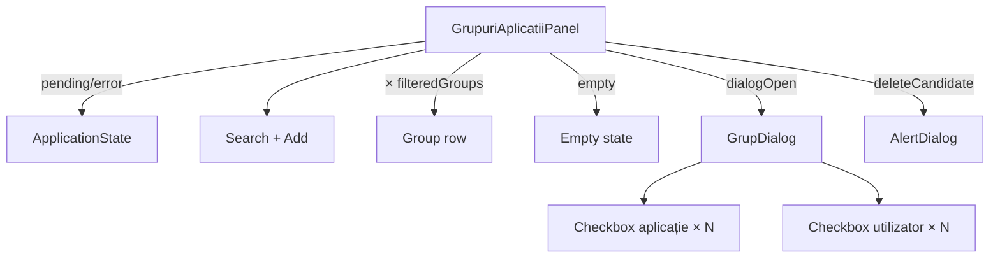

# Route: `/administrare/grupuri`

**Page component:** `frontend/src/pages/GrupuriAplicatiiPage.tsx` → `GrupuriAplicatiiPanel` din `frontend/src/features/utilizatori/GrupuriAplicatiiPanel.tsx`. Header: `GrupuriAplicatiiHeader`.

## React component tree

```text
<AuthenticationGate> → <AppShell> → <StaffRoute>
└── <AdministrationLayout>
    ├── <GrupuriAplicatiiHeader> → <AdminPageHeader>
    ├── <AdminRail />
    └── <GrupuriAplicatiiRoute>
        └── <Suspense fallback={<ApplicationState loading />}>
            └── <GrupuriAplicatiiPage>
                └── <GrupuriAplicatiiPanel>
                    ├── [groups/apps pending/error] <ApplicationState />
                    └── section
                        ├── search Input + add Button
                        ├── <Card> > <CardContent>
                        │   ├── ul > li × filteredGroups
                        │   │   └── icon + identity + edit Button + delete Button
                        │   └── [empty] div
                        ├── <GrupDialog> [open] → portal
                        │   └── <DialogContent>
                        │       ├── <DialogHeader />
                        │       └── form
                        │           ├── [save error] <Alert>
                        │           ├── group name Field
                        │           ├── application checkbox × applications
                        │           ├── user search + selection list
                        │           │   ├── [pending] li
                        │           │   └── user checkbox × visibleUsers
                        │           ├── selection pagination Buttons
                        │           └── footer Buttons
                        └── <AlertDialog> [deleteCandidate] → portal
                            └── title/description/cancel/delete
```

## Diagramă Mermaid



## DOM outline estimat

```text
main[data-slot=sidebar-inset] > div > div
└── div [AdministrationLayout]
    ├── header > breadcrumb + h1 "Grupuri și acces aplicații" + p
    └── div.lg:flex-row
        ├── AdminRail
        └── div.flex-1
            └── section.flex.min-w-0.flex-1.flex-col.gap-6 [GrupuriAplicatiiPanel]
                ├── div.flex
                │   ├── div.relative > svg + input[type=search]
                │   └── button "Adaugă grup"
                ├── div[data-slot=card]
                │   └── div[data-slot=card-content].p-0
                │       ├── ul > li × filteredGroups
                │       │   └── svg + div(p+p) + button edit + button delete
                │       └── div.min-h-52.text-center [empty] > svg + p
                ├── [portal Dialog]
                │   └── div[role=dialog]
                │       ├── div[data-slot=dialog-header] > h2 + p
                │       └── form.grid.gap-5
                │           ├── div[data-slot=alert] [error]
                │           ├── div[data-slot=field] > label + input#grup-name + error
                │           ├── div[data-slot=field] > label + p + ul > li/label/checkbox × applications
                │           ├── div[data-slot=field]
                │           │   ├── label + p + input[type=search]
                │           │   ├── ul > li pending + li/label/checkbox × visibleUsers
                │           │   └── div > span + div > button × 2
                │           └── div[data-slot=dialog-footer] > button × 2
                └── [portal AlertDialog]
                    └── div[role=alertdialog] > header(h2+p) + footer(button × 2)
```

## Endpointuri Django/API

| Metodă | Endpoint | Consumator/acțiune |
|---|---|---|
| `GET` | `/api/v1/utilizatori/grupuri` | `groupsQuery` |
| `GET` | `/api/v1/utilizatori/grupuri/aplicatii` | `applicationsQuery` |
| `GET` | `/api/v1/utilizatori/selectie?page={page}&page_size=20[&search=…]` | `selectionQuery` din dialog, numai când dialogul este deschis |
| `POST` | `/api/v1/utilizatori/grupuri` | creare grup |
| `PATCH` | `/api/v1/utilizatori/grupuri/{groupId}` | editare grup |
| `DELETE` | `/api/v1/utilizatori/grupuri/{groupId}` | confirmare ștergere |

Bootstrap/CSRF se aplică în plus.

## Stări, formulare și acțiuni

- pagina: loading combinat, error combinat, empty după filtrare;
- dialog: user search debounced, pending text, paginare; save error alert și field error pentru `name`;
- nu există stare error/empty pentru `selectionQuery`;
- acțiuni: add/edit/delete grup, selecție aplicații/utilizatori, paginare utilizatori, confirmare delete; toasts la succes și erori de mutație.

## Probleme structurale

- `GrupuriAplicatiiPanel` are 327 linii și include subcomponenta dialog cu query propriu, lista și confirmarea delete.
- Retry-ul erorii de pagină reapelează atât `groupsQuery`, cât și `applicationsQuery`.
- `selectionQuery` nu are error sau empty state; un rezultat gol produce o listă goală fără explicație.
- Dialogurile sunt corect portalizate și nu imbrică elemente interactive.
