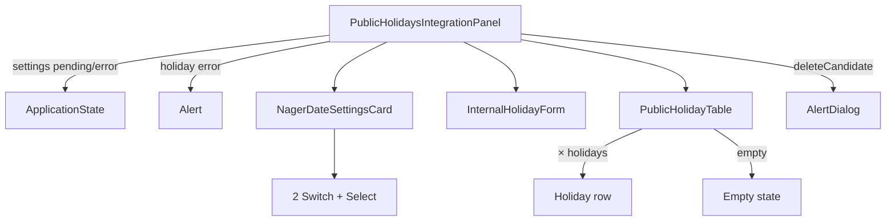

# Route: `/administrare/integrari/zile-libere`

**Page component:** `frontend/src/pages/PublicHolidaysIntegrationPage.tsx` → `PublicHolidaysIntegrationPanel` din `frontend/src/features/integrations/public-holidays/PublicHolidaysIntegrationPanel.tsx`. Header: `PublicHolidaysIntegrationHeader`.

## React component tree

```text
<AuthenticationGate> → <AppShell> → <StaffRoute>
└── <AdministrationLayout>
    ├── <PublicHolidaysIntegrationHeader>
    │   └── <AdminPageHeader> → Breadcrumb × 3 + <PageTitle /> + p
    ├── <AdminRail />
    └── <PublicHolidaysIntegrationRoute>
        └── <Suspense fallback={<ApplicationState loading />}>
            └── <PublicHolidaysIntegrationPage>
                └── <PublicHolidaysIntegrationPanel>
                    ├── [settings pending/error] <ApplicationState />
                    └── section
                        ├── [holidays error] <Alert>
                        ├── <NagerDateSettingsCard>
                        │   └── <Card>
                        │       ├── header + status Badge
                        │       ├── content
                        │       │   ├── Switch enabled
                        │       │   ├── Switch automatic
                        │       │   ├── Select frequency (item × 3)
                        │       │   └── dl status + [last_error]
                        │       └── footer save + sync Buttons
                        ├── div grid
                        │   ├── <InternalHolidayForm>
                        │   │   └── <Card> > form
                        │   │       ├── header
                        │   │       ├── inputs date/name + textarea
                        │   │       └── [editing] cancel + submit
                        │   └── <PublicHolidayTable>
                        │       └── <Card>
                        │           ├── header + year Input
                        │           └── content
                        │               ├── [loading] null
                        │               ├── [holidays] table > row × holidays
                        │               │   └── [english name] + Badge + edit/delete Buttons
                        │               └── [empty/error] empty state
                        └── <AlertDialog> [deleteCandidate] → portal
                            └── media + title + description + cancel/delete
```

## Diagramă Mermaid



## DOM outline estimat

```text
main[data-slot=sidebar-inset] > div > div
└── div [AdministrationLayout]
    ├── header > nav[breadcrumb] + h1 "Zile libere și sărbători" + p
    └── div.lg:flex-row
        ├── AdminRail
        └── div.flex-1
            └── section.flex.min-w-0.flex-1.flex-col.gap-6 [Panel]
                ├── div[data-slot=alert] [holidays error]
                ├── div[data-slot=card] [NagerDateSettingsCard]
                │   ├── div[data-slot=card-header] > div(svg+h3+description) + div > badge
                │   ├── div[data-slot=card-content].grid
                │   │   ├── div.space-y-5
                │   │   │   ├── div.border > div(label#for + p) + button#public-holidays-enabled[role=switch]
                │   │   │   ├── div.border > div(label + p) + button#public-holidays-automatic[role=switch]
                │   │   │   └── div > label + button#public-holidays-frequency [Select] → portal
                │   │   └── dl > div(dt+dd) × 4 + div last error [condiționat]
                │   └── div[data-slot=card-footer] > button save + button sync
                ├── div.grid.xl:grid-cols-[...]
                │   ├── div[data-slot=card] [InternalHolidayForm]
                │   │   └── form
                │   │       ├── header > svg + h3 + description
                │   │       ├── content.grid
                │   │       │   ├── div > label + input#internal-holiday-date[type=date]
                │   │       │   ├── div > label + input#internal-holiday-name
                │   │       │   └── div > label + textarea#internal-holiday-description
                │   │       └── footer > button cancel [editing] + button submit
                │   └── div[data-slot=card] [PublicHolidayTable]
                │       ├── header > svg + h3 + description + input[type=number][aria-label="An calendar"]
                │       └── content
                │           ├── div.overflow-x-auto > table.min-w-[48rem] [holidays]
                │           │   ├── thead > tr > th × 5
                │           │   └── tbody > tr × holidays
                │           │       ├── td date
                │           │       ├── td > span name + span english [condiționat]
                │           │       ├── td > badge
                │           │       ├── td description
                │           │       └── td > div > button edit + button delete
                │           └── div.min-h-56.text-center [empty] > svg + h2 + p
                └── [portal AlertDialog]
                    └── div[role=alertdialog] > header(media+h2+p) + footer(button × 2)
```

## Endpointuri Django/API

| Metodă | Endpoint | Hook/acțiune |
|---|---|---|
| `GET` | `/api/v1/integrations/public-holidays/settings` | `settingsQuery` |
| `PUT` | `/api/v1/integrations/public-holidays/settings` | `saveSettingsMutation` |
| `POST` | `/api/v1/integrations/public-holidays/sync` | `syncMutation` |
| `GET` | `/api/v1/integrations/public-holidays/holidays?year={year}` | `holidaysQuery` |
| `POST` | `/api/v1/integrations/public-holidays/internal` | creare zi internă |
| `PATCH` | `/api/v1/integrations/public-holidays/internal/{holidayId}` | editare zi internă |
| `DELETE` | `/api/v1/integrations/public-holidays/internal/{holidayId}` | ștergere confirmată |

Bootstrap și CSRF implicit se aplică suplimentar.

## Stări, formulare și acțiuni

- settings loading/error: `ApplicationState` cu retry;
- holidays loading: tabelul întoarce `null`, overlay global; error alert; empty dedicat;
- mutații: pending pe save/sync/create/update/delete, toasts la succes/eroare, cache invalidat;
- formular intern: add/edit/cancel, data/nume obligatorii, descriere;
- setări: enabled, automatic sync, frequency, save, sync manual;
- tabel: schimbare an, edit/delete numai pentru zile interne; dialog de confirmare delete.

## Probleme structurale

- La error al `holidaysQuery`, `loading` este fals și datele sunt `[]`; pagina afișează simultan alertul de eroare și empty state-ul „Nu există zile salvate”, care poate induce în eroare.
- Labelurile pentru switch-uri au `htmlFor`, iar switch-urile au ID-uri; interactivitatea este corect asociată. Nu există `h1` multiplu.
- Arborele este adânc din cauza layoutului admin și a celor trei carduri, dar folosește `form`, `table`, `dl`, `header` și dialog semantic.
