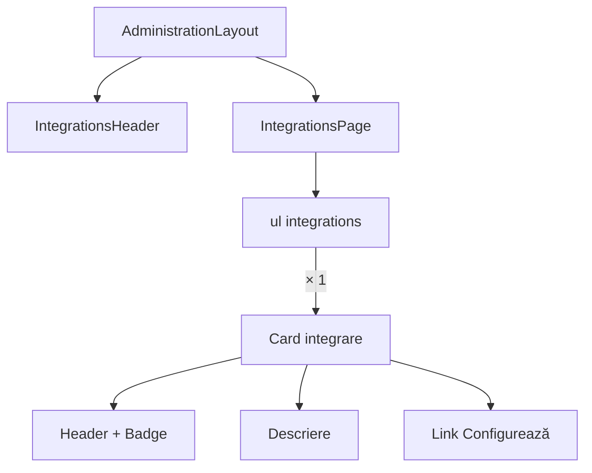

# Route: `/administrare/integrari`

**Page component:** `frontend/src/pages/IntegrationsPage.tsx`, încărcată lazy. Header: `IntegrationsHeader` → `AdminPageHeader`.

## React component tree

```text
<AuthenticationGate> → <AppShell> → <StaffRoute>
└── <AdministrationLayout>
    ├── <IntegrationsHeader> → <AdminPageHeader>
    │   └── Breadcrumb × 2 + <PageTitle /> + p
    ├── <AdminRail />
    └── <IntegrationsRoute>
        └── <Suspense fallback={<ApplicationState loading />}>
            └── <IntegrationsPage>
                └── section
                    └── ul
                        └── li × integrations (curent 1)
                            └── <Card>
                                ├── <CardHeader>
                                │   ├── icon + <CardTitle /> + <CardDescription />
                                │   └── <CardAction> > <Badge />
                                ├── <CardContent> > p
                                └── <CardFooter>
                                    └── <Button render={<Link />}> + icon
```

## Diagramă Mermaid



## DOM outline estimat

```text
main[data-slot=sidebar-inset] > div > div
└── div [AdministrationLayout]
    ├── header > nav[breadcrumb] + h1 "Integrări" + p
    └── div.lg:flex-row
        ├── AdminRail
        └── div.flex-1
            └── section.flex.min-w-0.flex-1.flex-col.gap-6 [IntegrationsPage]
                └── ul.grid.gap-4.md:grid-cols-2.xl:grid-cols-3
                    └── li × 1
                        └── div[data-slot=card].h-full
                            ├── div[data-slot=card-header]
                            │   ├── div > span > svg + div > h3 + div description
                            │   └── div[data-slot=card-action] > span badge
                            ├── div[data-slot=card-content] > p
                            └── div[data-slot=card-footer] > a[data-slot=button] > text + svg
```

## Endpointuri Django/API

- Numai `GET /api/v1/core/bootstrap`; catalogul folosește constanta locală `integrations`.

## Stări, formulare și acțiuni

- lazy loading/access denied comune;
- fără error/empty propriu deoarece lista este statică și conține un element;
- acțiune: link „Configurează” la `/administrare/integrari/zile-libere`; fără formular/mutație.

## Probleme structurale

- Duplică aproape integral structura cardurilor din `CoursePlannerPage`; un model de catalog comun ar reduce repetarea.
- Un singur `h1` din layout, listă semantică și link randat fără button nesting.

