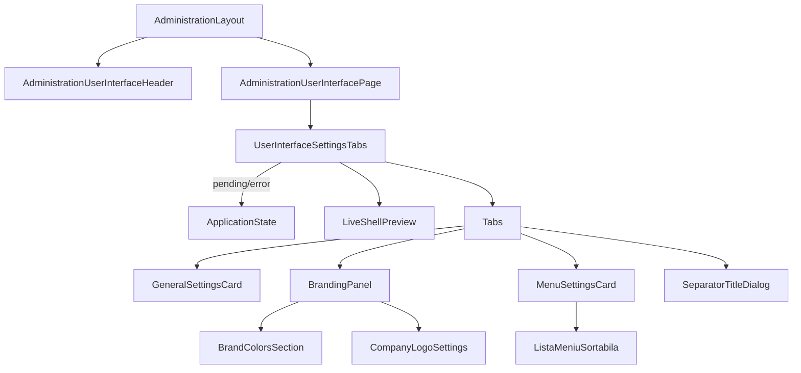

# Route: `/administrare/sistem/interfata-utilizator`

**Page component:** `frontend/src/pages/AdministrationUserInterfacePage.tsx` → `UserInterfaceSettingsTabs` din `frontend/src/features/branding/UserInterfaceSettingsTabs.tsx`. Header: `AdministrationUserInterfaceHeader` → `AdminPageHeader`.

## React component tree

```text
<AuthenticationGate> → <AppShell> → <StaffRoute>
└── <AdministrationLayout>
    ├── <AdministrationUserInterfaceHeader>
    │   └── <AdminPageHeader>
    │       ├── <Breadcrumb>: crumb × 2, separator × 1
    │       ├── <PageTitle />
    │       └── p
    ├── <AdminRail />: grup × 6, entry × date
    └── <AdministrationUserInterfaceRoute>
        └── <Suspense fallback={<ApplicationState loading />}>
            └── <AdministrationUserInterfacePage>
                └── section
                    └── <UserInterfaceSettingsTabs>
                        ├── [settings pending/error] <ApplicationState />
                        └── [settings success] div
                            ├── <LiveShellPreview>
                            │   ├── header vizual cu <SectionTitle />
                            │   ├── mock header
                            │   ├── nav > item × max. 6
                            │   │   └── <RandNavigatiePrevizualizare> [separator | link vizual]
                            │   └── [contrast redus] warning p
                            └── <Tabs defaultValue="general">
                                ├── <TabsList> → <TabsTrigger> × 3
                                ├── [tab general] <TabsContent>
                                │   └── <GeneralSettingsCard>
                                │       └── <Card> → header + form(input#nume-aplicatie) + footer
                                ├── [tab branding] <TabsContent>
                                │   └── <BrandingPanel>
                                │       └── <Card>
                                │           ├── header
                                │           └── content
                                │               ├── <BrandColorsSection>
                                │               │   └── form > fieldset > <CampCuloare> × 4
                                │               └── <CompanyLogoSettings>
                                │                   ├── [query pending/error] <ApplicationState />
                                │                   └── <FileUploadField> + preview + 2 Buttons
                                └── [tab meniu] <TabsContent>
                                    ├── <MenuSettingsCard>
                                    │   ├── [navigation error] p
                                    │   ├── [empty] div
                                    │   └── [items] <ListaMeniuSortabila>
                                    │       └── <DndContext>
                                    │           └── <SortableContext>
                                    │               └── <ElementMeniuSortabil> × items
                                    │                   ├── drag button
                                    │                   └── [separator] rename/delete Buttons
                                    └── <SeparatorTitleDialog> [open] → portal
                                        └── form > input#titlu-separator + Buttons
```

`useUserInterfaceSettings` deține cele două query-uri și cele cinci tipuri de mutații; `useCompanyLogoSettings` reutilizează query-ul setărilor prin aceeași cheie de cache.

## Diagramă Mermaid



## DOM outline estimat

```text
main[data-slot=sidebar-inset] > div > div
└── div [AdministrationLayout]
    ├── header [AdminPageHeader]
    │   └── div
    │       ├── nav[data-slot=breadcrumb] > ol > li/a + li separator + li/span
    │       ├── h1 "Interfață utilizator"
    │       └── p
    └── div.lg:flex-row
        ├── div[data-slot=card] > nav [AdminRail]
        └── div.flex-1
            └── section.flex...gap-6 [AdministrationUserInterfacePage]
                └── div.grid.w-full.gap-8 [UserInterfaceSettingsTabs]
                    ├── section.grid.gap-2[aria-label="Previzualizare live a interfeței"]
                    │   ├── div > svg + h2 + p
                    │   ├── div.rounded-xl.border
                    │   │   ├── div.h-11 [mock header] > img|span + div
                    │   │   └── div.flex.h-52
                    │   │       ├── nav[aria-label="Exemplu de navigație"]
                    │   │       │   └── ul > li × max. 6 > div [separator|item]
                    │   │       └── div.flex-1 > p + div + div > span + span
                    │   └── p.text-warning [contrast redus]
                    └── div[data-slot=tabs]
                        ├── div[role=tablist] > button[role=tab] × 3
                        ├── div[role=tabpanel] [general activ]
                        │   └── div[data-slot=card]
                        │       ├── div[data-slot=card-header] > ... > h3 + div + [badge]
                        │       └── form
                        │           ├── div[data-slot=card-content] > div > label + div > input#nume-aplicatie + p
                        │           └── div[data-slot=card-footer] > button
                        ├── div[role=tabpanel] [branding activ]
                        │   └── div[data-slot=card]
                        │       ├── div[data-slot=card-header] > h3 + descriere
                        │       └── div[data-slot=card-content]
                        │           ├── div > form [BrandColorsSection]
                        │           │   ├── div > h3 + p + [badge]
                        │           │   ├── fieldset > legend.sr-only + ul
                        │           │   │   └── li × 4 > div > label + div(input color + input#culoare-*) + p + [error p]
                        │           │   └── button
                        │           └── div > div [CompanyLogoSettings]
                        │               ├── h3 + p
                        │               ├── div.grid
                        │               │   ├── div [FileUploadField] > input#company-logo
                        │               │   └── div > p + div(img|empty div) + p
                        │               └── div > button upload + button delete
                        └── div[role=tabpanel] [meniu activ]
                            ├── div[data-slot=card]
                            │   ├── header > h3 + descriere + [badge]
                            │   ├── content > p error | div empty | ul
                            │   │   └── li × elemente > button drag + span + [button rename + button delete]
                            │   └── footer > button add + button save
                            └── [portal dialog open]
                                └── div[role=dialog] > form
                                    ├── header > h2 + p
                                    ├── div > label + input#titlu-separator
                                    └── footer > button × 2
```

ID-urile dinamice de culori sunt `culoare-culoare_primara`, `culoare-culoare_accent`, `culoare-culoare_fundal`, `culoare-culoare_titluri`.

## Endpointuri Django/API

| Metodă | Endpoint | Hook/acțiune |
|---|---|---|
| `GET` | `/api/v1/core/administration/user-interface` | `settingsQuery` în ambele hook-uri (deduplicat prin query key) |
| `PATCH` | `/api/v1/core/administration/user-interface` | salvare nume sau culori |
| `GET` | `/api/v1/core/administration/user-interface/navigation` | `navigationQuery` |
| `PUT` | `/api/v1/core/administration/user-interface/navigation` | salvarea ordinii |
| `POST` | `/api/v1/core/administration/user-interface/navigation` | adăugare separator |
| `PATCH` | `/api/v1/core/administration/user-interface/navigation/separators/{key}` | redenumire separator |
| `DELETE` | `/api/v1/core/administration/user-interface/navigation/separators/{key}` | eliminare separator |
| `POST` | `/api/v1/core/administration/user-interface/company-logo` | upload SVG |
| `DELETE` | `/api/v1/core/administration/user-interface/company-logo` | eliminare logo |

Bootstrap și CSRF implicit se aplică în plus.

## Stări, formulare și acțiuni

- settings loading/error cu retry; navigation loading este acoperit de overlay global, error apare în tabul Meniu;
- meniu empty explicit; logo empty explicit; validare locală pentru culori hex și SVG;
- formulare: nume aplicație, patru culori, upload logo, titlu separator;
- acțiuni: save nume/culori/ordine, drag-and-drop, add/rename/delete separator, upload/delete logo;
- toate succesele/erorile mutațiilor sunt toasts; badge „Nesalvat” marchează trei categorii de modificări.

## Probleme structurale

- Ramurile error ale `ApplicationState` (settings și logo) produc `main` imbricat în `SidebarInset`.
- Pagina are un arbore foarte adânc din cauza layoutului admin + tabs + cards + forms, dar folosește semantic `header`, `nav`, `section`, `form`, `fieldset`, `ul`.
- Tabul Branding are `CardTitle` (`h3`) urmat de subtitluri tot `h3`; ierarhia nu sare peste `h1`, dar nu distinge nivelul subsecțiunilor.
- Nu există `h1` multiplu sau interactive imbricate incorect; drag handle-urile și acțiunile sunt butoane surori.
