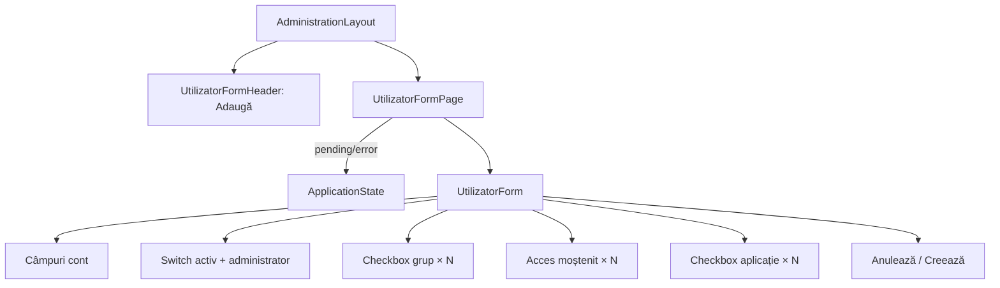

# Route: `/administrare/utilizatori/adaugare`

**Page component:** `frontend/src/pages/UtilizatorFormPage.tsx` → `UtilizatorForm` exportat din `frontend/src/features/utilizatori/UtilizatorDialog.tsx`. Header: `UtilizatorFormHeader` în modul „Adaugă”.

## React component tree

```text
<AuthenticationGate> → <AppShell> → <StaffRoute>
└── <AdministrationLayout>
    ├── <UtilizatorFormHeader>
    │   └── <AdminPageHeader> → Breadcrumb × 3 + <PageTitle /> + p
    ├── <AdminRail />
    └── <UtilizatorFormRoute>
        └── <Suspense fallback={<ApplicationState loading />}>
            └── <UtilizatorFormPage>
                ├── [groups/apps pending] <ApplicationState loading />
                ├── [groups/apps error] <ApplicationState />
                └── <UtilizatorForm user={null}>
                    └── section
                        └── form
                            ├── div grid → <Field> username/e-mail/prenume/nume
                            ├── <Field> parolă inițială
                            ├── div → două panouri cu <Switch> (activ/staff)
                            ├── <Field> grupuri
                            │   └── li/label/<Checkbox> × groups | empty li
                            ├── <Field> acces moștenit
                            │   └── li × aplicații moștenite | empty li
                            ├── <Field> acces direct
                            │   └── li/label/<Checkbox> × applications
                            └── <DialogFooter> → cancel + submit Buttons
```

Ramura superutilizator din `UtilizatorForm` nu poate fi activă la creare deoarece `user` este `null`.

## Diagramă Mermaid



## DOM outline estimat

```text
main[data-slot=sidebar-inset] > div > div
└── div [AdministrationLayout]
    ├── header > nav[breadcrumb] + h1 "Adaugă utilizator" + p
    └── div.lg:flex-row
        ├── AdminRail
        └── div.flex-1
            └── section.flex.min-w-0.flex-1.flex-col.gap-6 [UtilizatorForm]
                └── form.grid.max-w-4xl.gap-5
                    ├── div.grid.sm:grid-cols-2
                    │   ├── div[data-slot=field] > label[for=utilizator-username] + input#utilizator-username + div[data-slot=field-error]
                    │   ├── div[data-slot=field] > label + input#utilizator-email[type=email]
                    │   ├── div[data-slot=field] > label + input#utilizator-first-name
                    │   └── div[data-slot=field] > label + input#utilizator-last-name
                    ├── div[data-slot=field] > label + input#utilizator-password[type=password] + p + error div
                    ├── div.grid.sm:grid-cols-2
                    │   ├── div.border > div(p+p) + button[role=switch]
                    │   └── div.border > div(p+p) + button[role=switch]
                    ├── div[data-slot=field] > label + p + ul
                    │   └── li × groups > label > button[role=checkbox] + text | li empty
                    ├── div[data-slot=field] > label + p + ul
                    │   └── li × inheritedApplications | li empty
                    ├── div[data-slot=field] > label + p + ul
                    │   └── li × applications > label > button[role=checkbox] + text
                    └── div[data-slot=dialog-footer] > button "Anulează" + button[type=submit]
```

## Endpointuri Django/API

- `GET /api/v1/utilizatori/grupuri` — `groupsQuery`.
- `GET /api/v1/utilizatori/grupuri/aplicatii` — `applicationsQuery`.
- `POST /api/v1/utilizatori/` — `saveMutation` la submit.
- Bootstrap și CSRF implicit pentru POST.

## Stări, formulare și acțiuni

- loading combinat pentru grupuri/aplicații; error combinat fără retry;
- validare locală: username și parola inițială obligatorii; validările serverului ajung doar în toast generic prin `formatApiError`;
- empty grupuri explicit; lista de aplicații goală nu are mesaj dedicat; acces moștenit empty explicit;
- cancel navighează la listă; succesul invalidează query-urile, afișează toast și navighează; pending dezactivează formularul.

## Probleme structurale

- `UtilizatorForm` are 360 linii și combină date de identitate, status/rol și două modele de acces.
- `DialogFooter` este reutilizat într-o pagină care nu este dialog; produce un `div`, deci DOM-ul este valid, dar numele/abstracția nu corespunde contextului.
- Un singur `h1`; liste/fieldset-uri vizuale sunt în mare parte semantice, deși switch-urile nu au label HTML asociat direct.
