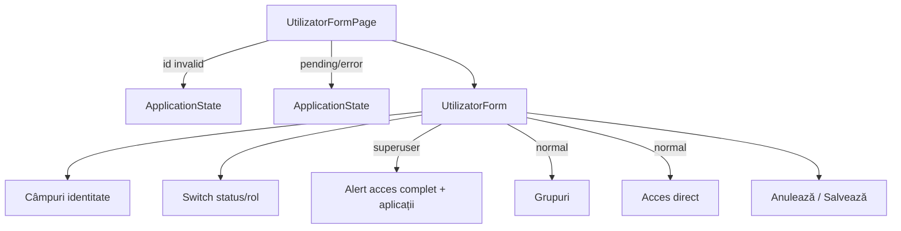

# Route: `/administrare/utilizatori/:userId`

**Page component:** `frontend/src/pages/UtilizatorFormPage.tsx` → `UtilizatorForm` din `frontend/src/features/utilizatori/UtilizatorDialog.tsx`. Header: `UtilizatorFormHeader` în modul „Editează” când parametrul este un întreg.

## React component tree

```text
<AuthenticationGate> → <AppShell> → <StaffRoute>
└── <AdministrationLayout>
    ├── <UtilizatorFormHeader>
    │   └── <AdminPageHeader> → Breadcrumb × 3 + <PageTitle /> + p
    ├── <AdminRail />
    └── <UtilizatorFormRoute>
        └── <Suspense fallback={<ApplicationState loading />}>
            └── <UtilizatorFormPage>
                ├── [userId invalid] <ApplicationState title="Utilizator indisponibil" />
                ├── [groups/apps/user pending] <ApplicationState loading />
                ├── [oricare query error] <ApplicationState />
                └── <UtilizatorForm user={userQuery.data}>
                    └── section > form
                        ├── fields identity × 5
                        ├── Switch activ + Switch staff
                        ├── [user superuser] <Field>
                        │   └── <Alert> + li × effective_applications
                        └── [user normal] fragment
                            ├── groups checkbox × groups | empty
                            ├── inherited app × computed list | empty
                            ├── direct app checkbox × applications
                            └── cancel/save Buttons
```

## Diagramă Mermaid



## DOM outline estimat

```text
main[data-slot=sidebar-inset] > div > div
└── div [AdministrationLayout]
    ├── header > nav[breadcrumb] + h1 "Editează utilizatorul" + p
    └── div.lg:flex-row
        ├── AdminRail
        └── div.flex-1
            └── section [UtilizatorForm]
                └── form.grid.max-w-4xl.gap-5
                    ├── div.grid > field div × 4
                    │   └── input#utilizator-username / #utilizator-email / #utilizator-first-name / #utilizator-last-name
                    ├── field div > input#utilizator-password + description + error
                    ├── div.grid > div + button[role=switch] × 2
                    ├── [superuser] div[data-slot=field]
                    │   ├── label
                    │   ├── div[data-slot=alert] > div[data-slot=alert-description]
                    │   └── ul > li × effective_applications
                    ├── [normal] div[data-slot=field] > ul > li/label/checkbox × groups
                    ├── [normal] div[data-slot=field] > ul > li × inheritedApplications
                    ├── [normal] div[data-slot=field] > ul > li/label/checkbox × applications
                    └── div[data-slot=dialog-footer] > button cancel + button submit

[invalid/error] ... > main.grid.min-h-svh [ApplicationState]
```

## Endpointuri Django/API

- `GET /api/v1/utilizatori/grupuri` — `groupsQuery`.
- `GET /api/v1/utilizatori/grupuri/aplicatii` — `applicationsQuery`.
- `GET /api/v1/utilizatori/{userId}` — `userQuery`, activ numai dacă `userId` este întreg.
- `PATCH /api/v1/utilizatori/{userId}` — `saveMutation`.
- Bootstrap și CSRF implicit pentru PATCH.

## Stări, formulare și acțiuni

- parametru invalid: stare indisponibilă fără retry/navigare; query-urile grupuri/aplicații sunt totuși inițiate înaintea returnului;
- loading/error combinat pentru trei query-uri; error fără retry;
- parolă opțională în editare; validare username locală;
- superuser: acces read-only complet; user normal: grupuri, acces moștenit și direct;
- cancel/success navighează la listă; save error toast.

## Probleme structurale

- `UtilizatorForm` are 360 linii și ramuri structurale mari pentru superuser vs user normal.
- Parametrul invalid nu oprește query-urile auxiliare; produce lucru/overlay inutil înaintea stării de eroare.
- Toate ramurile `ApplicationState` non-loading produc `main` imbricat și nu oferă acțiune de revenire/retry.
- `DialogFooter` este folosit în pagină, nu în dialog; DOM valid, abstracție contextuală nealiniată.

