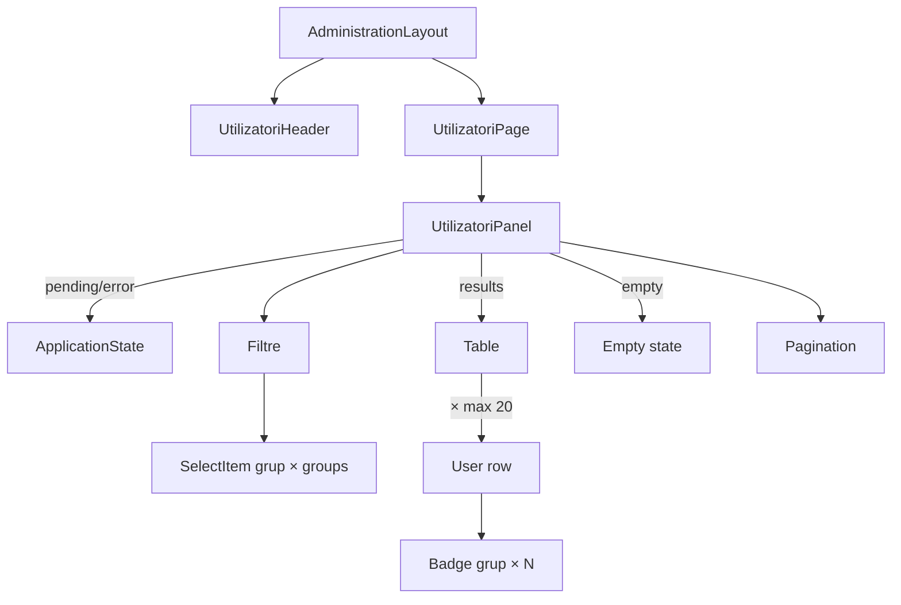

# Route: `/administrare/utilizatori`

**Page component:** `frontend/src/pages/UtilizatoriPage.tsx` → `UtilizatoriPanel` din `frontend/src/features/utilizatori/UtilizatoriPanel.tsx`. Header: `UtilizatoriHeader` → `AdminPageHeader`.

## React component tree

```text
<AuthenticationGate> → <AppShell> → <StaffRoute>
└── <AdministrationLayout>
    ├── <UtilizatoriHeader> → <AdminPageHeader>
    │   └── <Breadcrumb> + <PageTitle /> + p
    ├── <AdminRail />
    └── <UtilizatoriRoute>
        └── <Suspense fallback={<ApplicationState loading />}>
            └── <UtilizatoriPage>
                └── <UtilizatoriPanel>
                    ├── [users pending/error] <ApplicationState />
                    └── [success] section
                        ├── div > add Button
                        ├── <Card>
                        │   ├── <CardContent> filtre
                        │   │   ├── search <Input />
                        │   │   ├── status <Select />
                        │   │   ├── group <SelectItem> × groupsQuery.data
                        │   │   ├── role <Select />
                        │   │   └── count
                        │   ├── [results] <Table>
                        │   │   ├── header cu 8 coloane
                        │   │   └── row × usersQuery.data.results (max. 20)
                        │   │       ├── avatar text + identity
                        │   │       ├── <AccountTypeBadge />
                        │   │       ├── grup <Badge> × user.groups | „—”
                        │   │       ├── status badge
                        │   │       └── edit Button
                        │   └── [empty] icon + <SectionTitle /> + p
                        └── sumar + <Pagination>
```

## Diagramă Mermaid



## DOM outline estimat

```text
main[data-slot=sidebar-inset] > div > div
└── div [AdministrationLayout]
    ├── header > nav[breadcrumb] + h1 "Utilizatori" + p
    └── div.lg:flex-row
        ├── div[data-slot=card] > nav [AdminRail]
        └── div.flex-1
            └── section.flex.min-w-0.flex-1.flex-col.gap-6 [UtilizatoriPanel]
                ├── div.flex.justify-end > button "Adaugă utilizator"
                ├── div[data-slot=card].gap-0.py-0
                │   ├── div[data-slot=card-content].grid.border-b
                │   │   ├── div.relative > svg + input[type=search]
                │   │   ├── button [Select status] → portal
                │   │   ├── button [Select grup] → portal cu item × groups
                │   │   ├── button [Select rol] → portal
                │   │   └── div > span count
                │   ├── div[data-slot=table-container] > table.min-w-[64rem] [results]
                │   │   ├── thead > tr > th × 8
                │   │   └── tbody > tr × max. 20
                │   │       ├── td > div > span initials + div > p + p > code
                │   │       ├── td e-mail
                │   │       ├── td > span badge
                │   │       ├── td > ul > li × groups > span badge | li „—”
                │   │       ├── td > span status badge
                │   │       ├── td last login
                │   │       ├── td created
                │   │       └── td > div > button edit
                │   └── div.min-h-72.text-center [empty] > svg + h2 + p
                └── div.flex.justify-between
                    ├── p page count
                    └── nav[data-slot=pagination] > ul > li/a × 2

[users error] ... > section.grid.min-h-svh [ApplicationState]
```

## Endpointuri Django/API

- `GET /api/v1/utilizatori/?page={page}&page_size=20&role={role}&status={status}[&search=…][&group=…]` — `usersQuery`, cheia derivată din toate filtrele.
- `GET /api/v1/utilizatori/grupuri` — `groupsQuery`, pentru filtrul de grup.
- `GET /api/v1/core/bootstrap` — utilizator curent și permisiuni.

## Stări, formulare și acțiuni

- users loading/error: `ApplicationState`; error cu retry;
- users empty: stare dedicată; schimbarea filtrelor poate ieși din empty;
- groups loading activează overlay-ul global, dar lista principală poate exista prin query separat;
- căutare debounced 300 ms, trei filtre și paginare; add/edit navighează la rutele formularului;
- editarea unui superutilizator este dezactivată pentru staff nesuperuser.

## Probleme structurale

- `UtilizatoriPanel` are 362 linii și combină query-uri, debounce, filtre, tabel, permisiuni și paginare.
- `groupsQuery.isError` nu este tratat: selectul de grup poate apărea gol fără mesaj/retry.
- Tabelul lat (`64rem`) necesită wrapperul implicit `Table`; structura listelor de badge-uri este semantică și nu există interactive imbricate.
