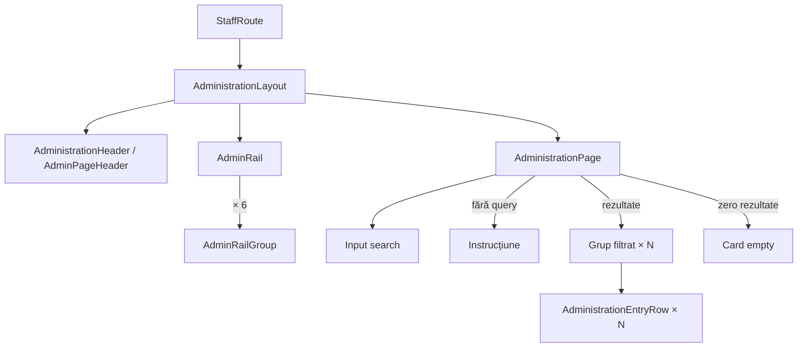

# Route: `/administrare`

**Page component:** `frontend/src/pages/AdministrationPage.tsx`, încărcată lazy prin `AdministrationRoute`. Headerul paginii este furnizat separat de handle-ul rutei: `AdministrationHeader` → `AdminPageHeader`.

## React component tree

```text
<AuthenticationGate> → <AppShell>
└── <StaffRoute>
    ├── [non-staff] <AccessDenied />
    └── [staff] <AdministrationLayout> — frontend/src/app/AdministrationLayout.tsx
        ├── <AdministrationHeader> — frontend/src/features/administration/AdministrationHeader.tsx
        │   └── <AdminPageHeader>
        │       └── header > <PageTitle /> + p
        └── div layout
            ├── <AdminRail> — frontend/src/features/administration/AdminRail.tsx
            │   └── <Card> > nav > ul
            │       └── <AdminRailGroup> × 6 administrationGroups
            │           └── <Collapsible>
            │               ├── <CollapsibleTrigger />
            │               └── <CollapsibleContent> > li × group.entries
            │                   └── <NavLink> | span „Curând”
            └── div > <AdministrationRoute>
                └── <Suspense fallback={<ApplicationState loading />}>
                    └── <AdministrationPage>
                        └── section
                            ├── div search > icon + <Input />
                            ├── [fără query] div instrucțiune
                            ├── [rezultate] ul
                            │   └── li × filteredGroups
                            │       └── section
                            │           ├── div > group Icon + <SectionTitle />
                            │           └── <Card> > ul
                            │               └── <AdministrationEntryRow> × group.entries
                            │                   └── li > <Link> | div
                            └── [query fără rezultate] <Card> > <CardContent>
```

## Diagramă Mermaid



## DOM outline estimat

```text
main[data-slot=sidebar-inset] > div > div
└── div.flex.min-w-0.flex-1.flex-col.gap-6 [AdministrationLayout]
    ├── header [AdminPageHeader]
    │   └── div > div
    │       ├── div > h1 "Administrare"
    │       └── p descriere
    └── div.flex...lg:flex-row
        ├── div[data-slot=card].sm:w-64 [AdminRail]
        │   └── nav[aria-label="Secțiuni de administrare"]
        │       └── ul
        │           └── li × 6
        │               └── div [Collapsible]
        │                   ├── button [trigger] > svg + span + svg
        │                   └── div [content] > ul > li × entries
        │                       └── a | span > span „Curând”
        └── div.min-w-0.flex-1
            └── section.flex.min-w-0.flex-1.flex-col.gap-6 [AdministrationPage]
                ├── div.relative
                │   ├── svg
                │   └── input[type=search][aria-label="Caută în administrare"]
                ├── div.border-dashed.text-center [fără query]
                │   └── svg + p
                ├── ul.grid.gap-10 [rezultate]
                │   └── li × filteredGroups
                │       └── section.grid
                │           ├── div > svg + h2
                │           └── div[data-slot=card] > ul
                │               └── li × entries
                │                   └── a | div.grid > p + p + svg|span
                └── div[data-slot=card] [zero rezultate]
                    └── div[data-slot=card-content] > svg + p + p
```

Nu există ID-uri. Conținutul collapsible al railului este condiționat de starea grupului; linkurile sunt generate numai pentru entry-urile cu `href`.

## Endpointuri Django/API

- `GET /api/v1/core/bootstrap` — aduce `user.is_staff`, navigația și accesul; nu există endpoint specific paginii.
- Căutarea filtrează constanta locală `administrationGroups` prin `useMemo`.

## Stări, formulare și acțiuni

- lazy loading și access denied comune;
- fără termen: instrucțiune de alegere/căutare;
- cu termen: grupuri/entry-uri filtrate sau empty „Nu am găsit rezultate”;
- control: input de căutare; acțiuni: linkuri către secțiunile implementate și collapsible-urile railului;
- fără hook de date/mutații.

## Probleme structurale

- `AdminRail` și rezultatele căutării redau aceeași taxonomie în două prezentări diferite; nu este duplicare între pagini, dar dublează navigarea în aceeași pagină.
- Conținutul paginii are `section` imbricat în `li`, justificat semantic de fiecare grup; adâncimea DOM este moderată, nu excesivă.
- Un singur `h1` vine din layout; pagina proprie folosește `h2` pentru grupuri.

