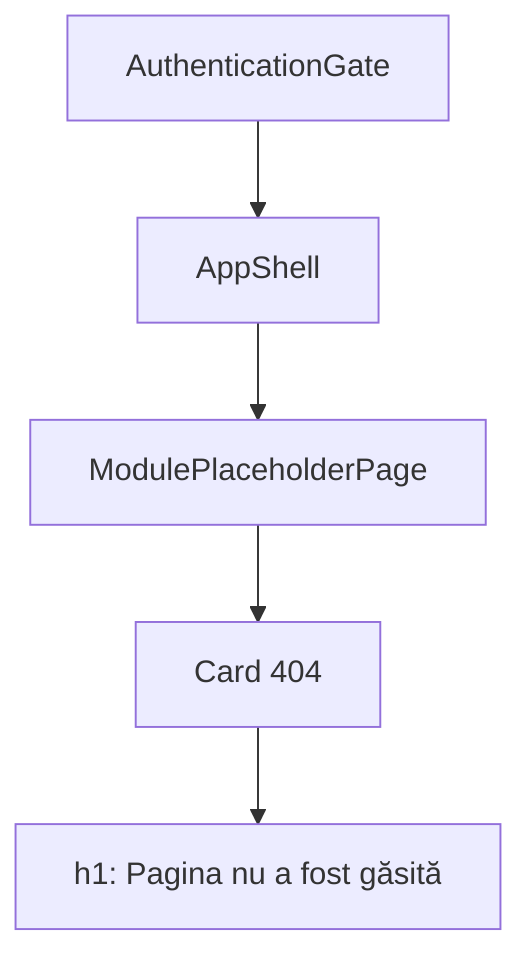

# Route: `*` (catch-all)

**Page component:** `ModulePlaceholderPage` din `frontend/src/pages/ModulePlaceholderPage.tsx`, configurat direct în `frontend/src/app/router.tsx` cu titlul „Pagina nu a fost găsită”.

## React component tree

```text
<AuthenticationGate>
└── [autentificat] <AppShell>
    └── <ModulePlaceholderPage>
        └── <section>
            └── <Card>
                ├── <CardHeader> → <CardDescription /> + <PageTitle />
                └── <CardContent> → p
```

Nu are `ApplicationAccessRoute`; orice utilizator autentificat ajunge la acest fallback pentru o cale necunoscută.

## Diagramă Mermaid



## DOM outline estimat

```text
main[data-slot=sidebar-inset] > div > div
└── section.flex.flex-1.items-center.justify-center [ModulePlaceholderPage]
    └── div[data-slot=card].w-full.max-w-2xl
        ├── div[data-slot=card-header]
        │   ├── div[data-slot=card-description] "Modul în pregătire"
        │   └── h1 "Pagina nu a fost găsită"
        └── div[data-slot=card-content]
            └── p "Ruta solicitată nu există în aplicație."
```

## Endpointuri Django/API

- Numai `GET /api/v1/core/bootstrap` și operațiile opționale ale shell-ului.

## Stări, formulare și acțiuni

- Stările comune bootstrap/login; pagina însăși este starea not-found.
- Fără formular, retry, link de întoarcere sau alte acțiuni.

## Probleme structurale

- Reutilizarea placeholderului face ca pagina 404 să afișeze descrierea generică „Modul în pregătire”, semantic nepotrivită pentru not-found.
- Lipsește o acțiune de revenire; cardul este wrapper integral al rutei.
- Are un singur `h1` și nu are interactivitate imbricată.

