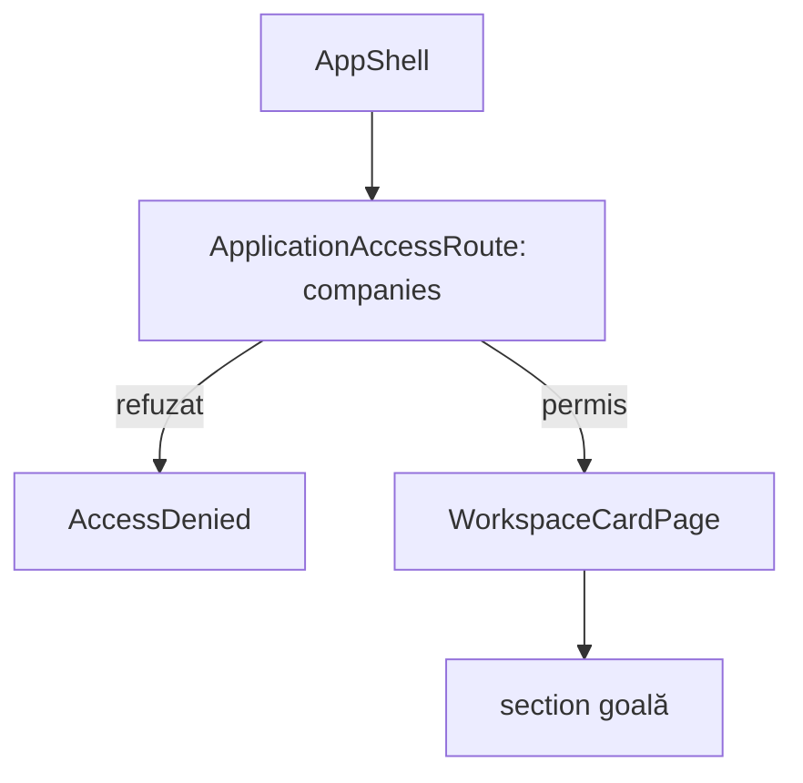

# Route: `/companies`

**Page component:** `WorkspaceCardPage` din `frontend/src/pages/WorkspaceCardPage.tsx`, cu `ariaLabel="Conținut companii"`. Este aliasul structural al rutei `/crm/companii`.

## React component tree

```text
<AuthenticationGate>
└── <AppShell>
    └── <ApplicationAccessRoute applicationKey="companies">
        ├── [fără acces] <AccessDenied />
        └── [cu acces] <WorkspaceCardPage>
            └── <section aria-label="Conținut companii" />
```

## Diagramă Mermaid



## DOM outline estimat

```text
main[data-slot=sidebar-inset] [AppShell]
└── div > div
    └── section.flex.min-h-full.flex-1[aria-label="Conținut companii"] [WorkspaceCardPage]
```

## Endpointuri Django/API

- Numai `GET /api/v1/core/bootstrap` și endpointurile opționale ale shell-ului.
- Nu există hook sau endpoint de companii în această rută.

## Stări, formulare și acțiuni

- Numai stările comune bootstrap/access denied.
- Fără loading/error/empty propriu, formular ori acțiune.

## Probleme structurale

- Nu are `h1`, text sau feedback empty; rezultatul cu acces permis este o pagină vizual goală.
- Duplică integral ruta `/crm/companii`; dacă ambele aliasuri sunt intenționate, documentarea/redirectul canonic ar trebui menținute explicit.

