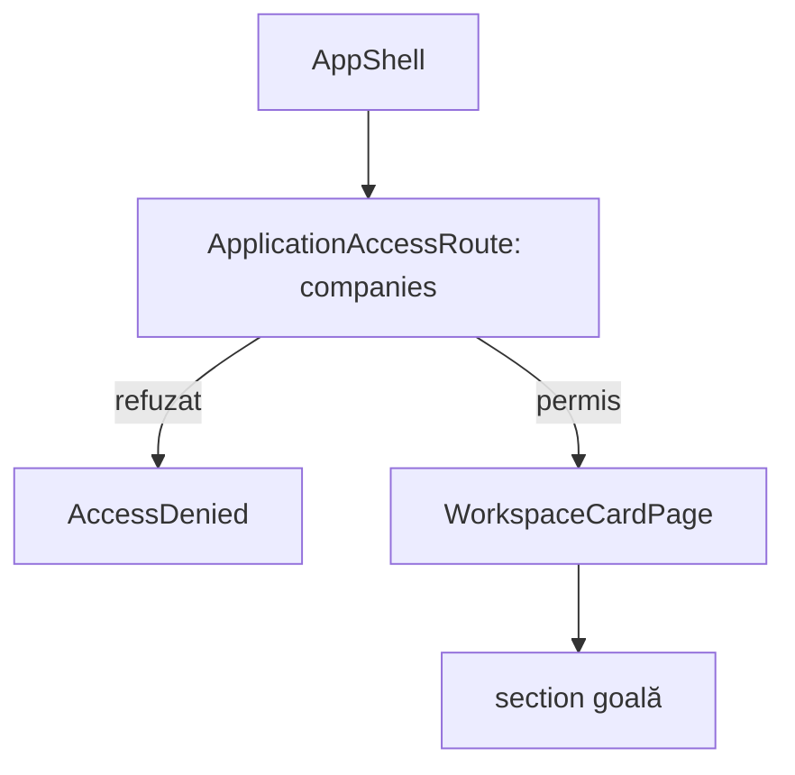

# Route: `/crm/companii`

**Page component:** `WorkspaceCardPage` din `frontend/src/pages/WorkspaceCardPage.tsx`, cu `ariaLabel="Conținut companii"`.

## React component tree

```text
<AuthenticationGate>
└── <AppShell>
    └── <ApplicationAccessRoute applicationKey="companies">
        ├── [fără acces] <AccessDenied />
        └── [cu acces] <WorkspaceCardPage>
            └── <section aria-label="Conținut companii" />
```

## Diagramă Mermaid



## DOM outline estimat

```text
main[data-slot=sidebar-inset] [AppShell]
└── div > div
    └── section.flex.min-h-full.flex-1[aria-label="Conținut companii"] [WorkspaceCardPage]
```

## Endpointuri Django/API

- Numai `GET /api/v1/core/bootstrap` și endpointurile opționale ale shell-ului.
- Nu există hook sau endpoint de companii în această rută.

## Stări, formulare și acțiuni

- Are doar stările comune bootstrap/access denied.
- Nu are loading/error/empty propriu, formular sau acțiune; secțiunea goală nu comunică utilizatorului că modulul nu are încă interfață.

## Probleme structurale

- Ruta nu are nici `h1`, nici text, nici stare empty vizibilă.
- Elementul `section` gol oferă doar o etichetă accesibilă; semantic, nu există conținut care să justifice secțiunea.
- Este identică structural cu aliasul `/companies`.

