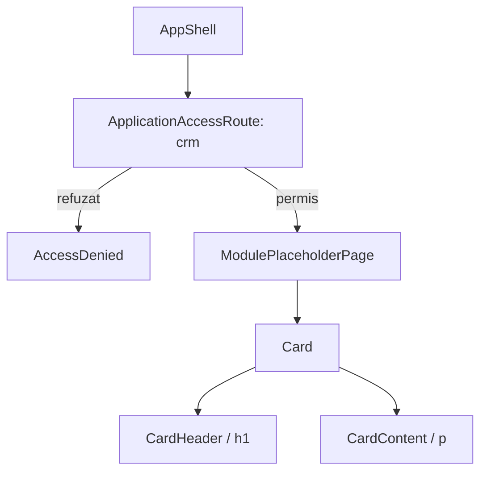

# Route: `/crm`

**Page component:** `ModulePlaceholderPage` din `frontend/src/pages/ModulePlaceholderPage.tsx`, configurat în `frontend/src/app/router.tsx` cu titlul „CRM”.

## React component tree

```text
<AuthenticationGate>
└── <AppShell>
    └── <ApplicationAccessRoute applicationKey="crm">
        ├── [fără acces] <AccessDenied />
        └── [cu acces] <ModulePlaceholderPage>
            └── <section>
                └── <Card>
                    ├── <CardHeader>
                    │   ├── <CardDescription />
                    │   └── <PageTitle />
                    └── <CardContent> > p
```

## Diagramă Mermaid



## DOM outline estimat

```text
main[data-slot=sidebar-inset] [AppShell]
└── div > div
    └── section.flex.flex-1.items-center.justify-center.p-4... [ModulePlaceholderPage]
        └── div[data-slot=card].w-full.max-w-2xl
            ├── div[data-slot=card-header].items-center.text-center
            │   ├── div[data-slot=card-description] "Modul în pregătire"
            │   └── h1 "CRM"
            └── div[data-slot=card-content]
                └── p "Alege un modul CRM..."
```

## Endpointuri Django/API

- Numai endpointurile comune: `GET /api/v1/core/bootstrap`; opțional CSRF + logout din shell.
- `ApplicationAccessRoute` citește `accessible_application_keys` din bootstrap și nu face request separat.

## Stări, formulare și acțiuni

- loading/error bootstrap și starea access denied sunt comune;
- pagina este chiar starea empty/„în pregătire”; nu are formular, hook de date sau acțiuni proprii.

## Probleme structurale

- `Card` este folosit ca wrapper pentru întregul conținut al rutei, deși convenția repo-ului rezervă cardurile secțiunilor reale.
- Structura are un singur `h1`, element semantic `section` și nu are nesting ori interactivitate problematică.

