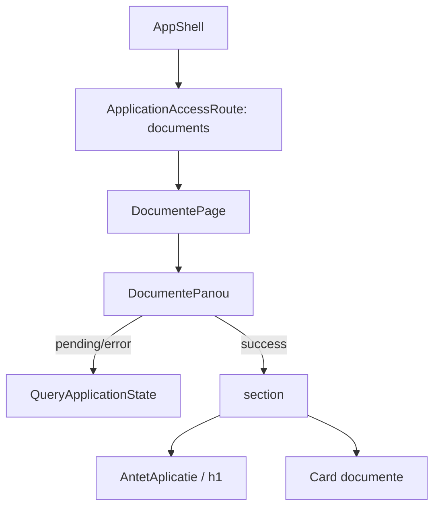

# Route: `/documente`

**Page component:** `frontend/src/pages/DocumentePage.tsx` → `DocumentePanou` din `frontend/src/features/documente/DocumentePanou.tsx`.

## React component tree

```text
<AuthenticationGate> → <AppShell>
└── <ApplicationAccessRoute applicationKey="documents">
    ├── [fără acces] <AccessDenied />
    └── [cu acces] <DocumentePage>
        └── <DocumentePanou>
            ├── [pending/error] <QueryApplicationState> → <ApplicationState />
            └── [success] <section aria-label="Documente">
                ├── <AntetAplicatie> → <PageTitle />
                └── <Card>
                    ├── <CardHeader> → <CardTitle /> + <CardDescription />
                    └── <CardContent> → p
```

## Diagramă Mermaid



## DOM outline estimat

```text
main[data-slot=sidebar-inset] > div > div
└── section.flex.min-w-0.flex-1.flex-col.gap-6[aria-label="Documente"] [DocumentePanou]
    ├── header [AntetAplicatie] > h1 [PageTitle]
    └── div[data-slot=card]
        ├── div[data-slot=card-header]
        │   ├── h3[data-slot=card-title]
        │   └── div[data-slot=card-description]
        └── div[data-slot=card-content] > p.text-base.leading-6.text-muted-foreground

[error] main[data-slot=sidebar-inset] > div > div
└── section.grid.min-h-svh [ApplicationState]
```

## Endpointuri Django/API

- `GET /api/v1/core/bootstrap` — comun.
- `GET /api/v1/documente/rezumat` — `DocumentePanou.useQuery`, cheia `['documente', 'rezumat']`, `staleTime` 5 minute.

## Stări, formulare și acțiuni

- loading: overlay global;
- error: `ApplicationState` cu retry/refetch;
- empty: cardul de succes spune explicit că nu există documente disponibile;
- fără formular sau mutații.

## Probleme structurale

- Nu există `h1` multiplu, nesting excesiv sau interactive imbricate.
