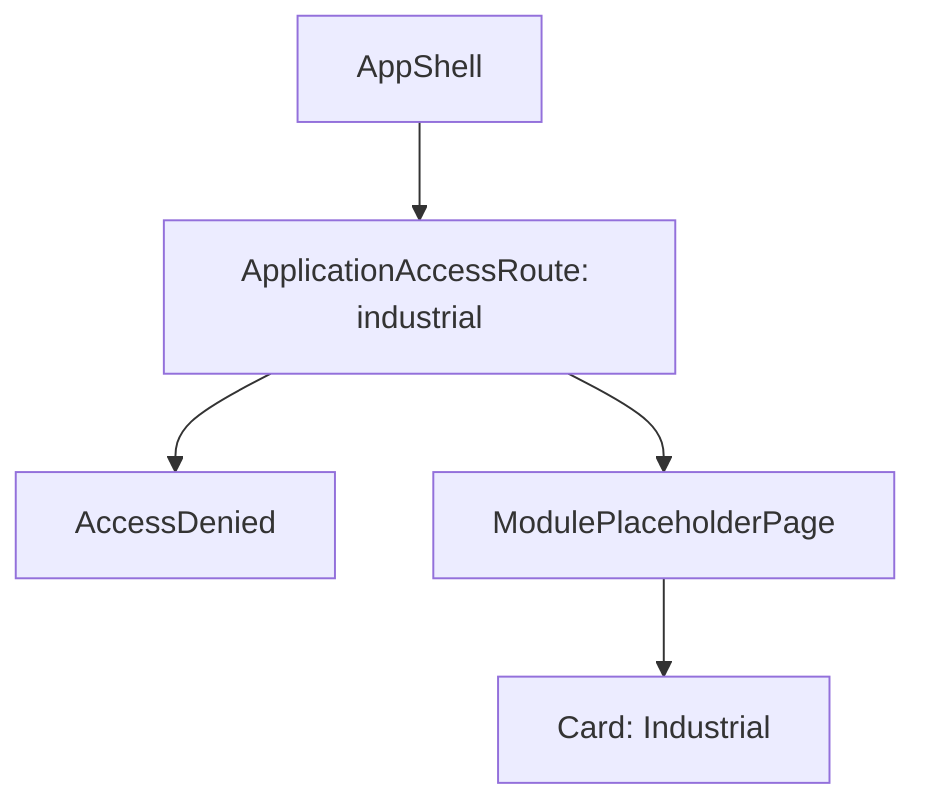

# Route: `/industrial/in-pregatire`

**Page component:** `ModulePlaceholderPage` din `frontend/src/pages/ModulePlaceholderPage.tsx`, titlu „Industrial”.

## React component tree

```text
<AuthenticationGate> → <AppShell>
└── <ApplicationAccessRoute applicationKey="industrial">
    ├── [fără acces] <AccessDenied />
    └── [cu acces] <ModulePlaceholderPage>
        └── <section> → <Card> → <CardHeader>(<CardDescription />, <PageTitle />) + <CardContent>(p)
```

## Diagramă Mermaid



## DOM outline estimat

```text
main[data-slot=sidebar-inset] > div > div
└── section.flex.flex-1.items-center.justify-center [ModulePlaceholderPage]
    └── div[data-slot=card].w-full.max-w-2xl
        ├── div[data-slot=card-header] > div[data-slot=card-description] + h1 "Industrial"
        └── div[data-slot=card-content] > p "Modulele pentru Industrial vor fi definite ulterior."
```

## Endpointuri Django/API

- Numai `GET /api/v1/core/bootstrap`; gardianul citește cheia `industrial`.

## Stări, formulare și acțiuni

- Stări comune bootstrap/access denied; placeholder vizibil.
- Fără hook, formular sau acțiune.

## Probleme structurale

- Card folosit drept wrapper integral; nu sunt alte probleme structurale evidente.

