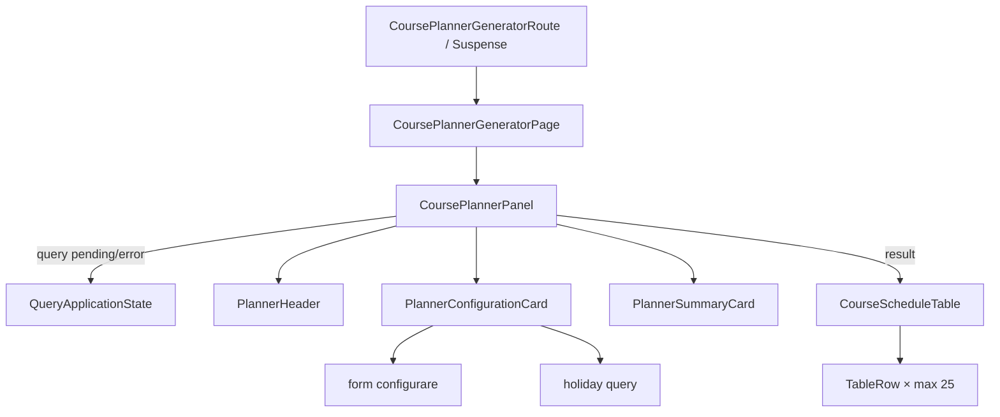

# Route: `/planificator-cursuri/generator`

**Page component:** `frontend/src/pages/CoursePlannerGeneratorPage.tsx` → `CoursePlannerPanel` din `frontend/src/features/course-planner/CoursePlannerPanel.tsx`, încărcat lazy prin `CoursePlannerGeneratorRoute`.

## React component tree

```text
<AuthenticationGate> → <AppShell>
└── <ApplicationAccessRoute applicationKey="course-planner">
    └── <CoursePlannerGeneratorRoute>
        └── <Suspense fallback={<ApplicationState loading />}>
            └── <CoursePlannerGeneratorPage>
                └── <section>
                    └── <CoursePlannerPanel>
                        ├── [settings pending/error] <QueryApplicationState> → <ApplicationState />
                        └── [success] div
                            ├── <PlannerHeader>
                            │   └── <AntetAplicatie>
                            │       ├── <PageTitle />
                            │       └── <Button render={<Link />}> × 2
                            ├── div.grid
                            │   ├── <PlannerConfigurationCard>
                            │   │   └── form
                            │   │       ├── section configurare
                            │   │       │   ├── <SectionTitle />
                            │   │       │   ├── <FileUploadField />
                            │   │       │   ├── select an + slider + input numeric
                            │   │       │   ├── fieldset
                            │   │       │   │   └── <Button> lună × 12
                            │   │       │   └── section zile libere
                            │   │       │       ├── [nicio lună] p
                            │   │       │       ├── [holiday error] p + retry Button
                            │   │       │       └── [holiday success] li × holidays | empty p
                            │   │       └── acțiuni save + generate
                            │   └── <PlannerSummaryCard>
                            │       └── aside
                            │           ├── <SummaryRow /> × 5
                            │           ├── <ArtifactStatus /> × 3
                            │           ├── [fără rezultat] empty state
                            │           └── download Button
                            └── [result] div#scroll-target
                                └── <CourseScheduleTable>
                                    └── section#planificare-generata
                                        ├── header vizual
                                        ├── <Table>
                                        │   ├── <TableHeader>: 3 coloane + lună × 12
                                        │   └── <TableBody>: rând × maximum 25/pagină
                                        │       └── celule fixe + lună × 12
                                        └── [peste 25 rânduri] <Pagination>
```

Surse tranzitive principale: `components/PlannerHeader.tsx`, `PlannerConfigurationCard.tsx`, `PlannerSummaryCard.tsx`, `CourseScheduleTable.tsx` și `frontend/src/components/FileUploadField.tsx`.

## Diagramă Mermaid



## DOM outline estimat

```text
main[data-slot=sidebar-inset] > div > div
└── section.relative.flex.min-h-[calc(100svh-4rem)] [CoursePlannerGeneratorPage]
    └── div.flex.w-full.flex-1.flex-col.gap-6 [CoursePlannerPanel]
        ├── header [AntetAplicatie/PlannerHeader]
        │   ├── h1 "Generare perioade cursuri"
        │   └── div > a[data-slot=button] × 2
        ├── div.grid...xl:grid-cols-[minmax(0,1fr)_22rem]
        │   ├── form.grid.gap-8 [PlannerConfigurationCard]
        │   │   ├── section.grid.gap-6
        │   │   │   ├── div > h2 + p
        │   │   │   └── div.grid.gap-7
        │   │   │       ├── div.grid.gap-2 [FileUploadField]
        │   │   │       │   ├── div > label[for=course-file] + button [condiționat]
        │   │   │       │   ├── div.drop-zone
        │   │   │       │   │   ├── input#course-file[type=file].sr-only
        │   │   │       │   │   └── label[for=course-file] > span + span
        │   │   │       │   └── p
        │   │   │       ├── div.grid.border-y
        │   │   │       │   ├── div > label[for=planner-year] + button#planner-year [Select trigger] + p
        │   │   │       │   ├── div > label[for=randomness] + div > div#randomness[role=slider] + span + p
        │   │   │       │   └── div > label[for=xml-start-post-id] + input#xml-start-post-id[type=number] + p
        │   │   │       ├── fieldset > legend + div(button × 2) + ul
        │   │   │       │   └── li × 12 > button[aria-pressed] > span + text
        │   │   │       └── section.flex.border-l-2
        │   │   │           └── svg + div > p + p
        │   │   │               ├── p [nicio lună]
        │   │   │               ├── div + button [error]
        │   │   │               └── div > p + (ul > li × holidays | p empty) [success]
        │   │   └── div.flex.border-t > button[type=button] + button[type=submit]
        │   └── aside.xl:sticky [PlannerSummaryCard]
        │       ├── div > h2 + p
        │       ├── div.grid
        │       │   ├── div > div × 5 [SummaryRow]
        │       │   ├── div > p + div × 3 [ArtifactStatus]
        │       │   └── div.text-center [fără rezultat]
        │       └── button [download]
        └── div.scroll-mt-20 [result]
            └── section#planificare-generata.border-t [CourseScheduleTable]
                ├── div > div(h2 + p) + p
                ├── div.border-y
                │   └── div[data-slot=table-container] > table
                │       ├── caption.sr-only
                │       ├── thead > tr > th × 15
                │       └── tbody > tr × max. 25 > td × 15
                └── nav[data-slot=pagination] [pageCount > 1]
```

Conținutul `SelectContent` este portalizat când este deschis. Ref-ul wrapperului rezultatului nu adaugă ID; ID-ul real este `planificare-generata` pe secțiunea tabelului.

## Endpointuri Django/API

| Metodă | Endpoint | Hook/acțiune |
|---|---|---|
| `GET` | `/api/v1/course-planner/settings` | `settingsQuery` (`useQuery`, cheia `coursePlannerQueryKey`) |
| `PUT` | `/api/v1/course-planner/settings` | `saveMutation`, buton „Salvează setările” |
| `GET` | `/api/v1/course-planner/holidays?year=…&months=…` | `holidaysQuery` din `PlannerConfigurationCard`, activ numai cu cel puțin o lună |
| `POST` | `/api/v1/course-planner/generate` | `generateMutation`, multipart cu fișier și setări |
| `GET` | `/api/v1/course-planner/history/{generationId}/files/excel` | `downloadMutation` |

Orice request unsafe poate declanșa mai întâi `GET /api/v1/auth/csrf`.

## Stări, formulare și acțiuni

- setări loading/error: `QueryApplicationState`; error are retry;
- zile libere: query dezactivat fără luni, global loading când rulează, error inline cu retry, success cu listă sau empty explicit;
- rezultat: rezumatul are empty explicit; tabelul apare numai după generare;
- formular: fișier CSV/XLS/XLSX, an, distribuție 1–10, ID XML, 12 luni; select all/clear, save, generate;
- mutații: pending dezactivează controalele și schimbă etichetele; erorile/succesele sunt Sonner; download salvează blob-ul;
- tabel: paginare locală la 25 de cursuri.

## Probleme structurale

- `PlannerConfigurationCard` are 277 linii și combină upload, setări, query de zile libere, validare vizuală și acțiuni; este o componentă mare.
- Loading-ul zilelor libere nu are placeholder local; overlay-ul global blochează întreaga aplicație pentru un query secundar.
- Tabelul are lățime minimă de `118rem` și 15 coloane, deci DOM și scroll orizontal substanțiale; nestingul este justificat de formular/tabel, dar adânc.
- Nu există `h1` multiplu sau interactive imbricate incorect.
