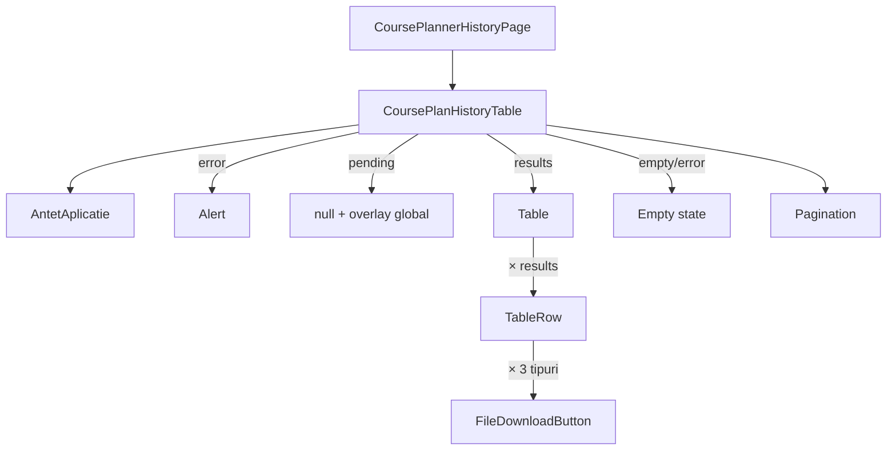

# Route: `/planificator-cursuri/istoric`

**Page component:** `frontend/src/pages/CoursePlannerHistoryPage.tsx` → `CoursePlanHistoryTable` din `frontend/src/features/course-planner/CoursePlanHistoryTable.tsx`, încărcată lazy.

## React component tree

```text
<AuthenticationGate> → <AppShell>
└── <ApplicationAccessRoute applicationKey="course-planner">
    └── <CoursePlannerHistoryRoute>
        └── <Suspense fallback={<ApplicationState loading />}>
            └── <CoursePlannerHistoryPage>
                └── <section aria-label="Istoric generări planificator cursuri">
                    └── <CoursePlanHistoryTable>
                        └── div
                            ├── <AntetAplicatie> → <PageTitle />
                            ├── [history/download error] <Alert>
                            ├── section tabel
                            │   ├── [pending] null
                            │   ├── [results] <Table>
                            │   │   ├── header cu 7 coloane
                            │   │   └── <TableRow> × results (max. 25)
                            │   │       └── 7 celule; ultima conține <FileDownloadButton> × 3
                            │   └── [fără rezultate sau query error] empty state
                            └── div sumar + <Pagination> (întotdeauna randată)
```

## Diagramă Mermaid



## DOM outline estimat

```text
main[data-slot=sidebar-inset] > div > div
└── section.min-h-full[aria-label="Istoric generări planificator cursuri"] [CoursePlannerHistoryPage]
    └── div.flex.min-w-0.flex-col.gap-5 [CoursePlanHistoryTable]
        ├── header > h1 "Istoric generări"
        ├── div[data-slot=alert][aria-live=polite] [error]
        │   └── div[data-slot=alert-description]
        ├── section.min-w-0.overflow-hidden.rounded-sm.border
        │   ├── [pending] fără copii
        │   ├── div[data-slot=table-container] > table.min-w-[58rem] [results]
        │   │   ├── thead > tr > th × 7
        │   │   └── tbody > tr × results
        │   │       ├── td data
        │   │       ├── td > code filename
        │   │       ├── td an
        │   │       ├── td luni
        │   │       ├── td cursuri
        │   │       ├── td autor
        │   │       └── td > div > button × 3 (Excel/Word/XML)
        │   └── div.min-h-64.text-center [empty]
        │       └── svg + h2 + p
        └── div.flex...justify-between
            ├── p [count/pagină]
            └── nav[data-slot=pagination]
                └── ul > li > a × 2
```

Nu există ID-uri; linkurile de paginare folosesc `href="#"` cu `preventDefault`.

## Endpointuri Django/API

- `GET /api/v1/course-planner/history?page={page}&page_size=25` — `historyQuery.useQuery`, cheia `['course-planner','history',page]`.
- `GET /api/v1/course-planner/history/{generationId}/files/{excel|word|xml}` — `downloadMutation` pentru fiecare buton disponibil.
- `GET /api/v1/core/bootstrap` — comun.

## Stări, formulare și acțiuni

- loading: secțiunea tabelului rămâne goală; overlay global oferă singurul feedback;
- error: alert inline; retry explicit nu există;
- empty: icon + `h2` + descriere;
- download pending dezactivează numai butonul fișierului curent; eroarea download este afișată în același alert;
- paginare anterior/următor; fără formular.

## Probleme structurale

- La error al query-ului, `data` este absentă, deci pagina afișează simultan alertul de eroare și empty state-ul „Nu există generări salvate”; empty-ul este înșelător.
- Loading-ul local este `null`, dependent complet de overlay-ul global.
- `CoursePlanHistoryTable` are 267 linii și combină query, download, tabel, empty/error și paginare.
- Pagination folosește ancore cu `href="#"` pentru acțiuni de stare locală; funcționează cu `preventDefault`, dar butoanele ar exprima mai direct acțiunea.

