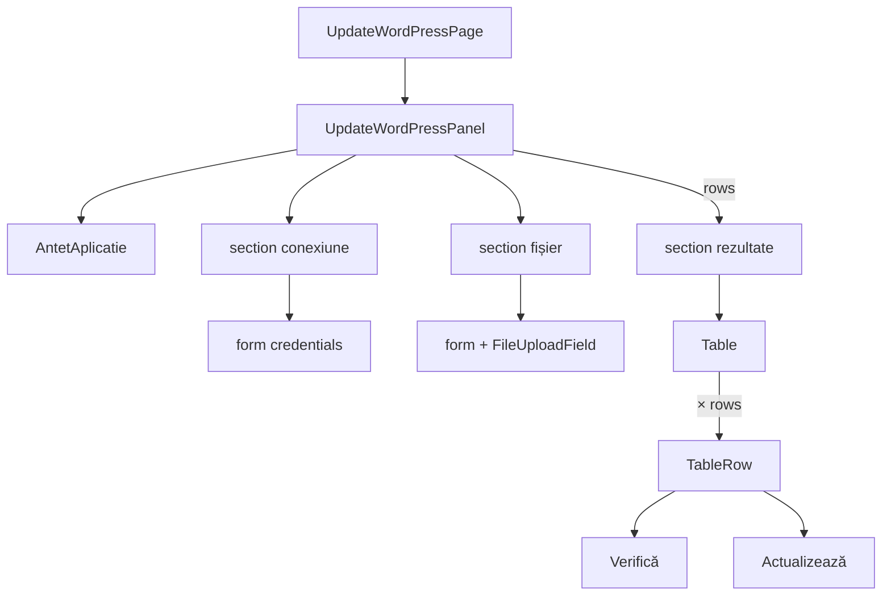

# Route: `/planificator-cursuri/update-wordpress`

**Page component:** `frontend/src/pages/UpdateWordPressPage.tsx` → `UpdateWordPressPanel` din `frontend/src/features/update-wordpress/UpdateWordPressPanel.tsx`, încărcată lazy.

## React component tree

```text
<AuthenticationGate> → <AppShell>
└── <ApplicationAccessRoute applicationKey="course-planner">
    └── <UpdateWordPressRoute>
        └── <Suspense fallback={<ApplicationState loading />}>
            └── <UpdateWordPressPage>
                └── <section>
                    └── <UpdateWordPressPanel>
                        └── div
                            ├── <AntetAplicatie> → <PageTitle />
                            ├── section conexiune
                            │   ├── <SectionTitle /> + p
                            │   ├── [connected] <Alert>
                            │   └── form
                            │       ├── <Field> URL
                            │       ├── div → <Field> username + <Field> app password
                            │       └── submit Button
                            ├── section preview fișier
                            │   ├── <SectionTitle /> + p
                            │   └── form → <FileUploadField /> + submit Button
                            └── [rows !== null] section rezultate
                                ├── <SectionTitle /> + descriere condiționată de credențiale
                                └── <Table>
                                    ├── header cu 5 coloane
                                    └── row × rows
                                        ├── curs/date/date propuse
                                        ├── <Badge> [5 ramuri de stare]
                                        └── Button verifică + Button actualizează
```

## Diagramă Mermaid



## DOM outline estimat

```text
main[data-slot=sidebar-inset] > div > div
└── section.relative.flex.min-h-[calc(100svh-4rem)] [UpdateWordPressPage]
    └── div.flex.w-full.flex-1.flex-col.gap-6 [UpdateWordPressPanel]
        ├── header > h1 "Update WordPress"
        ├── section.grid.max-w-2xl.rounded-sm.border.p-6 [conexiune]
        │   ├── div > h2 + p
        │   ├── div[data-slot=alert] > svg + div[data-slot=alert-description] [connected]
        │   └── form.grid.gap-5
        │       ├── div[data-slot=field] > label[for=wp-base-url] + input#wp-base-url[type=url]
        │       ├── div.grid.sm:grid-cols-2
        │       │   ├── div[data-slot=field] > label + input#wp-username
        │       │   └── div[data-slot=field] > label + input#wp-app-password[type=password] + p
        │       └── div > button[type=submit]
        ├── section.grid.max-w-2xl.rounded-sm.border.p-6 [preview]
        │   ├── div > h2 + p
        │   └── form
        │       ├── div [FileUploadField] > ... > input#update-wordpress-input-file[type=file]
        │       └── div > button[type=submit]
        └── section.grid.min-w-0.rounded-sm.border.p-6 [rows]
            ├── div > h2 + p
            └── div.overflow-hidden.border
                └── div[data-slot=table-container] > table.min-w-[54rem]
                    ├── thead > tr > th × 5
                    └── tbody > tr × rows
                        ├── td title
                        ├── td date Excel
                        ├── td date finale
                        ├── td > span[data-slot=badge] [error/updated/verified/ready]
                        └── td > div > button "Verifică" + button "Actualizează"
```

## Endpointuri Django/API

| Metodă | Endpoint | Consumator/acțiune |
|---|---|---|
| `GET` | `/api/v1/update-wordpress/settings` | `settingsQuery.useQuery`, cheia `['update-wordpress','settings']`; precompletează URL/username |
| `POST` | `/api/v1/update-wordpress/connect` | `connectMutation`, formular credențiale |
| `POST` | `/api/v1/update-wordpress/preview` | `previewMutation`, fișier multipart |
| `POST` | `/api/v1/update-wordpress/fetch-current-dates` | `handleVerify`, apel imperativ pentru fiecare rând |
| `POST` | `/api/v1/update-wordpress/update-row` | `handleUpdate`, apel imperativ pentru fiecare rând |

Toate POST-urile pot declanșa `GET /api/v1/auth/csrf`; bootstrapul comun rămâne obligatoriu.

## Stări, formulare și acțiuni

- settings query: pending activează overlay-ul global; datele precompletează două câmpuri;
- connect: success alert + toast, error toast, pending dezactivează formularul;
- preview: upload, pending și toasts; `rows` controlează apariția rezultatului;
- fiecare rând are fazele `idle`, `verifying`, `verified`, `updating`, `updated`, `error`, cu badge și mesaj;
- formulare: credențiale WordPress și fișier CSV/XLS/XLSX; acțiuni per rând pentru verificare/actualizare.

## Probleme structurale

- `UpdateWordPressPanel` are 394 linii și gestionează query, trei formulare conceptuale, credențiale, upload, tabel și stare asincronă per rând; este componenta de pagină cea mai mare analizată.
- `settingsQuery.isError` nu este randat explicit. Pagina rămâne cu câmpuri goale și doar query-ul în stare error, fără mesaj/retry.
- Un preview cu `rows: []` produce secțiune și tabel goale, fără empty state.
- Erorile de connect/preview sunt numai toasts; cele per rând persistă în badge.
- Nu există `h1` multiplu ori interactive imbricate incorect; nestingul de `div` este moderat-ridicat în cele trei blocuri.

