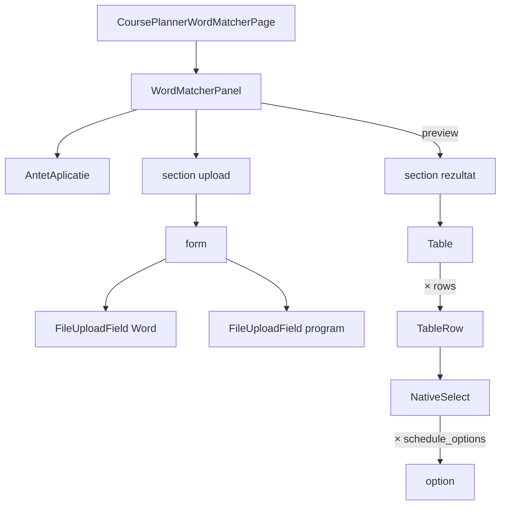

# Route: `/planificator-cursuri/word-matcher`

**Page component:** `frontend/src/pages/CoursePlannerWordMatcherPage.tsx` → `WordMatcherPanel` din `frontend/src/features/course-planner/WordMatcherPanel.tsx`, încărcată lazy.

## React component tree

```text
<AuthenticationGate> → <AppShell>
└── <ApplicationAccessRoute applicationKey="course-planner">
    └── <CoursePlannerWordMatcherRoute>
        └── <Suspense fallback={<ApplicationState loading />}>
            └── <CoursePlannerWordMatcherPage>
                └── <section>
                    └── <WordMatcherPanel>
                        └── div
                            ├── <AntetAplicatie> → <PageTitle />
                            ├── section upload
                            │   ├── <SectionTitle /> + p
                            │   └── form
                            │       ├── <FileUploadField id="word-matcher-word-file" />
                            │       ├── <FileUploadField id="word-matcher-schedule-file" />
                            │       └── submit Button
                            └── [preview] section rezultat
                                ├── div → <SectionTitle /> + p + generate Button
                                └── div → <Table>
                                    ├── header cu 4 coloane
                                    └── row × preview.rows
                                        ├── title
                                        ├── <Badge> [matched | review]
                                        ├── <NativeSelect>
                                        │   ├── opțiune omit
                                        │   └── <NativeSelectOption> × preview.schedule_options
                                        └── scor
```

## Diagramă Mermaid



## DOM outline estimat

```text
main[data-slot=sidebar-inset] > div > div
└── section.relative.flex.min-h-[calc(100svh-4rem)] [CoursePlannerWordMatcherPage]
    └── div.flex.w-full.flex-1.flex-col.gap-6 [WordMatcherPanel]
        ├── header > h1 "Word Matcher"
        ├── section.grid.max-w-3xl.rounded-sm.border.p-6
        │   ├── div > h2 + p
        │   └── form.grid.gap-6.sm:grid-cols-2
        │       ├── div [FileUploadField] > ... > input#word-matcher-word-file[type=file]
        │       ├── div [FileUploadField] > ... > input#word-matcher-schedule-file[type=file]
        │       └── div.sm:col-span-2 > button[type=submit]
        └── section.grid.min-w-0.rounded-sm.border.p-6 [preview]
            ├── div.flex.flex-wrap
            │   ├── div > h2 + p
            │   └── button[type=button] [generate]
            └── div.overflow-hidden.border
                └── div[data-slot=table-container] > table.min-w-[46rem]
                    ├── thead > tr > th × 4
                    └── tbody > tr × preview.rows
                        ├── td title
                        ├── td > span[data-slot=badge] > svg + text
                        ├── td > div[data-slot=native-select-wrapper]
                        │   └── select > option "omite" + option × schedule_options
                        └── td scor
```

## Endpointuri Django/API

- `POST /api/v1/course-planner/word-match/preview` — `previewMutation`, multipart cu document Word și program.
- `POST /api/v1/course-planner/word-match/generate` — `generateMutation`, JSON cu fișier base64, opțiuni și selecții; răspuns blob.
- `GET /api/v1/auth/csrf` implicit înaintea POST-urilor; bootstrap comun.

## Stări, formulare și acțiuni

- inițial: două drop-zone-uri și fără secțiunea rezultat;
- pending preview/generate: controale/text adaptate + overlay global;
- error/success: toasts; nu există alert persistent ori retry;
- preview: fiecare rând poate fi potrivit cu un curs sau omis; badge condiționat;
- generate este dezactivat fără cel puțin o potrivire și descarcă DOCX.

## Probleme structurale

- Dacă preview-ul conține zero rânduri, se afișează un tabel gol, fără empty state dedicat.
- Fiecare rând repetă toate `schedule_options`, rezultând `rows × options` elemente `option`; poate deveni un DOM foarte mare.
- Nu există `h1` multiplu sau interactive imbricate; structura de upload și rezultat folosește semantic `section`/`form`/`table`.

