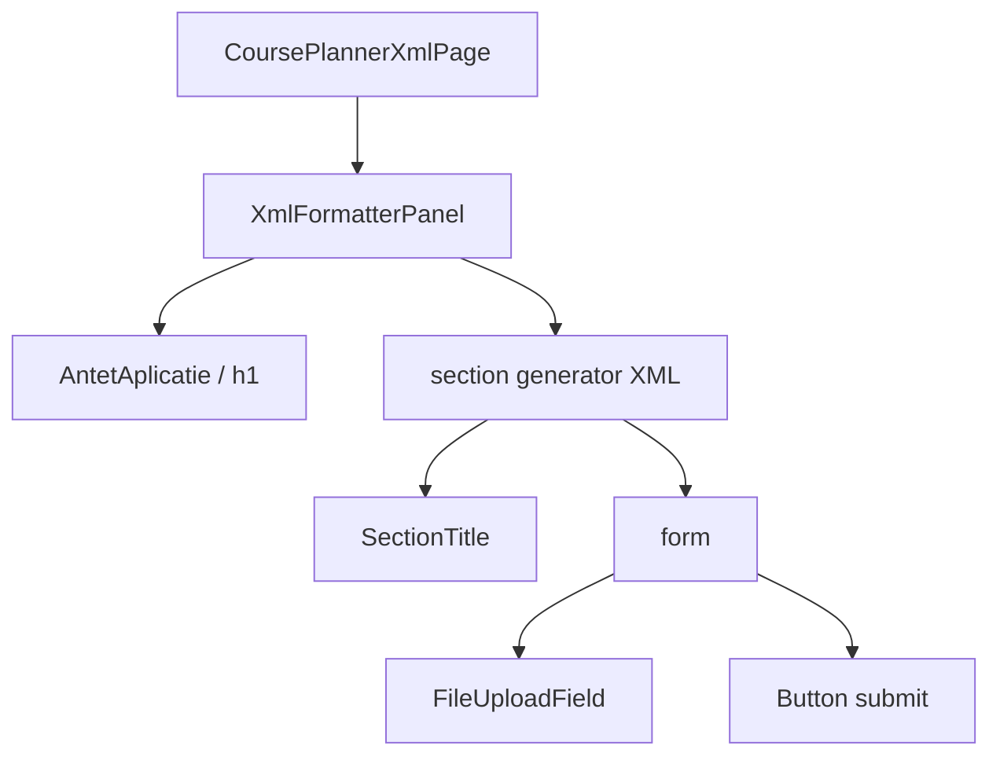

# Route: `/planificator-cursuri/xml`

**Page component:** `frontend/src/pages/CoursePlannerXmlPage.tsx` → `XmlFormatterPanel` din `frontend/src/features/course-planner/XmlFormatterPanel.tsx`, încărcată lazy.

## React component tree

```text
<AuthenticationGate> → <AppShell>
└── <ApplicationAccessRoute applicationKey="course-planner">
    └── <CoursePlannerXmlRoute>
        └── <Suspense fallback={<ApplicationState loading />}>
            └── <CoursePlannerXmlPage>
                └── <section>
                    └── <XmlFormatterPanel>
                        └── div
                            ├── <AntetAplicatie> → <PageTitle />
                            └── section
                                ├── div → <SectionTitle /> + p
                                └── form
                                    ├── <FileUploadField>
                                    │   ├── [file] remove Button
                                    │   └── input[type=file] + label drop-zone
                                    └── div → submit <Button>
```

## Diagramă Mermaid



## DOM outline estimat

```text
main[data-slot=sidebar-inset] > div > div
└── section.relative.flex.min-h-[calc(100svh-4rem)] [CoursePlannerXmlPage]
    └── div.flex.w-full.flex-1.flex-col.gap-6 [XmlFormatterPanel]
        ├── header > h1 "XML cursuri"
        └── section.grid.max-w-2xl.rounded-sm.border.p-6
            ├── div > h2 "Generează XML pentru WordPress" + p
            └── form.grid.gap-6
                ├── div.grid.gap-2 [FileUploadField]
                │   ├── div > label[for=xml-input-file] + button [file selectat]
                │   ├── div.drop-zone
                │   │   ├── input#xml-input-file[type=file].sr-only
                │   │   └── label[for=xml-input-file] > span(svg) + span
                │   └── p
                └── div.flex.justify-end > button[type=submit]
```

## Endpointuri Django/API

- `POST /api/v1/course-planner/format-xml` — `formatMutation` (`useMutation`), multipart cu `input_file`; răspuns blob descărcat local.
- `GET /api/v1/auth/csrf` implicit dacă lipsește cookie-ul; `GET /api/v1/core/bootstrap` comun.

## Stări, formulare și acțiuni

- inițial/empty: drop-zone fără fișier selectat;
- pending: buton/input dezactivate, text „Se generează…”, overlay global;
- error/success: toast Sonner; nu există alert inline;
- formular: un fișier CSV/XLS/XLSX; submit validează doar prezența și generează/descărcă XML.

## Probleme structurale

- Nu are stare error persistentă ori retry inline; feedbackul dispare odată cu toastul.
- Structura este semantică (`section`, `form`, un singur `h1`) și nu are nesting excesiv sau interactive imbricate.

