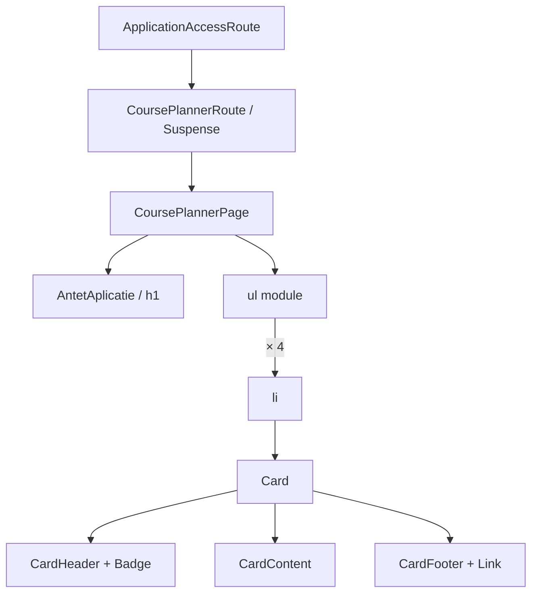

# Route: `/planificator-cursuri`

**Page component:** `frontend/src/pages/CoursePlannerPage.tsx`, încărcată lazy prin `CoursePlannerRoute` din `frontend/src/app/router.tsx`.

## React component tree

```text
<AuthenticationGate> → <AppShell>
└── <ApplicationAccessRoute applicationKey="course-planner">
    ├── [fără acces] <AccessDenied />
    └── [cu acces] <CoursePlannerRoute>
        └── <Suspense fallback={<ApplicationState loading />}>
            └── <CoursePlannerPage>
                └── <section>
                    ├── <AntetAplicatie> — frontend/src/components/AntetAplicatie.tsx
                    │   └── <PageTitle />
                    └── <ul>
                        └── <li> × 4 din plannerModules
                            └── <Card>
                                ├── <CardHeader>
                                │   ├── div
                                │   │   ├── span > <Icon /> (CalendarRange/History/FileCode2/ScanText)
                                │   │   └── div > <CardTitle /> + <CardDescription />
                                │   └── <CardAction> > <Badge />
                                ├── <CardContent> > p
                                └── <CardFooter>
                                    └── <Button render={<Link />}>
                                        └── text + <ArrowRight />
```

`Button` este randat direct ca link (`a`), nu ca `button > a`.

## Diagramă Mermaid



## DOM outline estimat

```text
main[data-slot=sidebar-inset] > div > div
└── section.flex.min-w-0.flex-1.flex-col.gap-6 [CoursePlannerPage]
    ├── header [AntetAplicatie]
    │   └── h1 "Planificator cursuri"
    └── ul.grid.gap-4.md:grid-cols-2.xl:grid-cols-3
        └── li × 4
            └── div[data-slot=card].h-full
                ├── div[data-slot=card-header]
                │   ├── div.flex.items-start.gap-3
                │   │   ├── span.grid.size-10 > svg
                │   │   └── div.min-w-0
                │   │       ├── h3[data-slot=card-title]
                │   │       └── div[data-slot=card-description]
                │   └── div[data-slot=card-action] > span[data-slot=badge]
                ├── div[data-slot=card-content] > p
                └── div[data-slot=card-footer]
                    └── a[data-slot=button][href=module.href] > text + svg
```

Nu există ID-uri. Cele patru linkuri duc la `generator`, `istoric`, `xml` și `word-matcher`; `update-wordpress` este rută validă, dar nu apare în lista `plannerModules`.

## Endpointuri Django/API

- Numai `GET /api/v1/core/bootstrap` și endpointurile opționale ale shell-ului.
- Pagina de catalog nu are hook de date sau request specific.

## Stări, formulare și acțiuni

- lazy loading: fallback `ApplicationState loading` + overlay global;
- acces refuzat: `AccessDenied`;
- nu are error/empty propriu deoarece lista este constantă în cod;
- acțiuni: patru linkuri de navigare; fără formulare/mutații.

## Probleme structurale

- Compoziția cardului este aproape duplicată în `IntegrationsPage`.
- Ruta validă `update-wordpress` nu este descoperibilă din acest catalog; aceasta este o discrepanță de navigare, nu de DOM.
- Un singur `h1`, listă semantică și fără interactivitate imbricată incorect.

