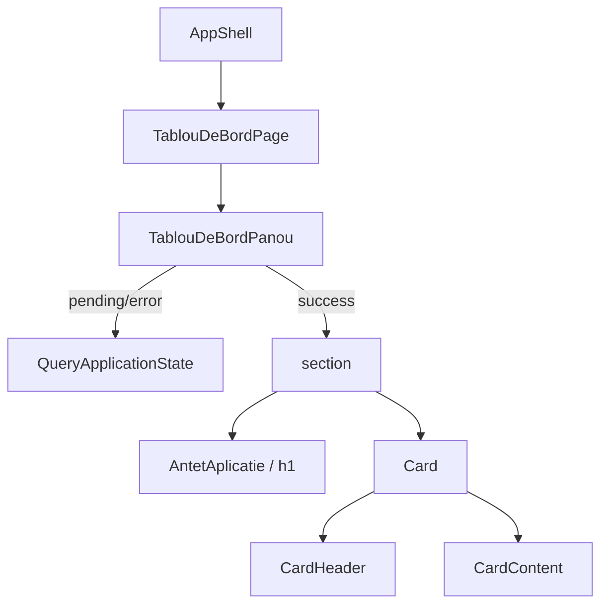

# Route: `/tablou-de-bord`

**Page component:** `frontend/src/pages/TablouDeBordPage.tsx` → `TablouDeBordPanou` din `frontend/src/features/tablou-de-bord/TablouDeBordPanou.tsx`.

## React component tree

```text
<AuthenticationGate>
└── <AppShell>
    ├── <AppHeader />
    ├── <AppSidebar />
    └── <SidebarInset> (= main)
        └── <TablouDeBordPage>
            └── <TablouDeBordPanou>
                ├── [pending/error] <QueryApplicationState>
                │   └── <ApplicationState />
                └── [success] <section>
                    ├── <AntetAplicatie>
                    │   └── <PageTitle />
                    └── <Card>
                        ├── <CardHeader>
                        │   ├── <CardTitle />
                        │   └── <CardDescription />
                        └── <CardContent> > p
```

## Diagramă Mermaid



## DOM outline estimat

```text
main[data-slot=sidebar-inset] [AppShell]
└── div > div
    └── section.flex.min-w-0.flex-1.flex-col.gap-6[aria-label="Tablou de bord"] [TablouDeBordPanou]
        ├── header.flex... [AntetAplicatie]
        │   └── h1.text-2xl... [PageTitle]
        └── div[data-slot=card] [Card]
            ├── div[data-slot=card-header]
            │   ├── h3[data-slot=card-title]
            │   └── div[data-slot=card-description]
            └── div[data-slot=card-content]
                └── p.text-base.leading-6.text-muted-foreground

[error]
main[data-slot=sidebar-inset] > div > div > main.grid.min-h-svh [ApplicationState]
```

Nu există ID-uri în DOM-ul de succes.

## Endpointuri Django/API

- `GET /api/v1/core/bootstrap` — comun, `AuthenticationGate.useQuery`.
- `GET /api/v1/tablou-de-bord/rezumat` — `TablouDeBordPanou.useQuery`, cheia `['tablou-de-bord', 'rezumat']`, `staleTime` 5 minute.
- `GET /api/v1/auth/csrf` și `POST /api/v1/auth/logout` numai dacă utilizatorul se deconectează din shell.

## Stări, formulare și acțiuni

- loading: overlay global prin `QueryApplicationState`/`ApplicationState loading`;
- error: card de eroare cu buton „Încearcă din nou”, care face `refetch`;
- empty: succesul afișează explicit că momentan nu există module configurate;
- nu are formular sau mutații proprii.

## Probleme structurale

- Ramura error produce un al doilea `main` în `SidebarInset` (`main > main`).
- Cardul este o secțiune reală de stare, nu doar wrapper de pagină; nu există `div` nesting excesiv, `h1` multiplu sau interactivitate imbricată.

